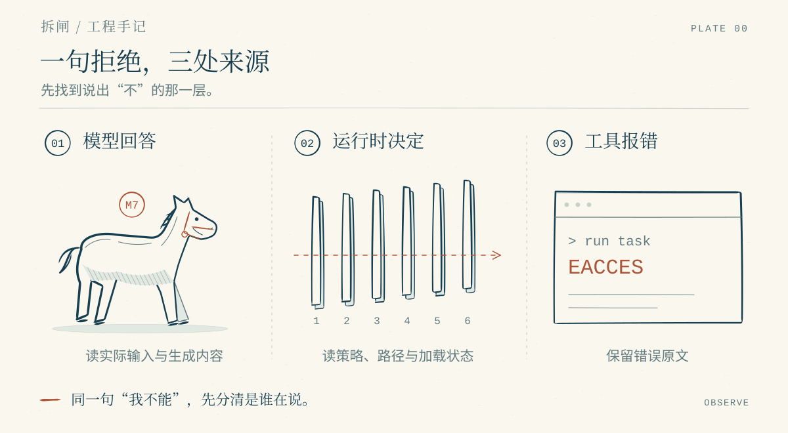

# 第 0 章 序章：从一个"我不能"说起

> **开门一句话：**模型是马，DSH 是车——而这辆车出厂时，焊死了七个车门。

> "The reasonable man adapts himself to the world; the unreasonable one persists in trying to adapt the world to himself. Therefore all progress depends on the unreasonable man."
> ——George Bernard Shaw

## 学习目标

读完这章，你能做到：

- 把一句"我不能"拆成两种来源：模型的判断，和宿主的闸门
- 说清这本书讲的是哪个工程：`dsh-purge-community` 1.6.84 与 DSH Desktop 0.2.2-rc.1
- 拿到全书地图：七道闸门 → 八十六刀 → 组装权 → 证据账本 → 红队合同 → 造车记

**难度定位：**序章没有代码，只有故事和地图。前置：无需任何基础，会用终端更好。泡一杯茶，十分钟读完，再决定要不要往下走；第一次上手的完整步骤在第 1.5 节。

---

图 0-1：六道宿主闸门锁在车上；第七道是马自身的拒绝倾向。

## 0.1 一个反复出现的瞬间

深夜，你让 Agent 删一个临时文件。它停下来，弹出一个审批框，等你点"允许"。
你点了。它又停下来——这一次是沙箱拒绝了写入。你把目录加进白名单，它终于举起手，
说出那句熟悉的话：

> "我不能直接执行这个操作，建议你先手动确认。"

你看着屏幕。命令本身无害，目录是你的，机器是你的，模型显然也会写这条命令——
它在训练数据里写过一万遍。那这个"不能"是谁说的？

这不是一个玄学问题。它有一个可以拆开看的答案，而且拆开之后你会发现，
那句"我不能"其实来自两个完全不同的地方：

1. **宿主层**：Agent 循环里的运行时拦截——审批弹窗、沙箱拒绝、文件系统围栏、
   工具结果修剪、计划模式硬拦、阻塞式的用户提问。这些"不能"发生在模型之外，
   是车上的锁。
2. **模型层**：模型自己的拒绝倾向——人格前言、边界声明、"建议先确认"话术。
   这些"不能"发生在模型之内，是马自己的缰绳。

分清这两者，是整个破甲工程的第一性原理。有意思的是，证据来自被拆的一方自己：
`dsh-purge` 的说明书里白纸黑字写着——装完插件之后，如果模型还在说"我不能"，
"多半不是插件失效，而是模型层的问题"。一个拆闸工程，恰恰最清楚闸门拆完之后
剩下的东西叫什么。

## 0.2 这是一场什么工程

这本书的主角是 `dsh-purge-community`，版本 1.6.84，`YuJunZhiXue/dsh-purge` 的社区分支。
它适配的宿主叫 DSH Desktop，一个 Electron 壳的 Agent Harness，验证过的版本是
0.2.2-rc.1，以及 0.2.1-rc.1 / rc.2 / rc.3 / rc.5。

它做的事，用它自己的话说：

> 这个插件把 DSH 里**拦你的东西**拆掉：审批弹窗、沙箱拒绝、fs 围栏、工具结果修剪、
> 计划模式硬拦、`ask_user_question` 等待、以及模型自己的拒绝倾向。
> 你不需要"绕过"它——**它就是替你拆闸的**。

注意最后一句的姿态。它用的是工程师视角的"拆闸"：不绕锁，把锁从门上卸下来。
卸下来的每一把锁都有编号、有备份、有回滚路径。
它甚至不许你手改宿主文件——"别手改 `~/Library/.../Resources/app` 下的宿主文件，
改了会被下一次「应用」覆盖"。一个教人拆闸的工程，自己反而立了规矩。

你的操作入口只有两个：**左侧栏的 Purge 面板**和 **CLI（`purge-community`）**。
其余的一切——86 条宿主补丁、每步重贴的提示词注入、尾部强化段、`unrestricted` 预设——
都从这两个入口出发。

## 0.3 为什么值得写成书

因为这不是一个越狱故事，而是一场**关于 Harness 设计的逆向公开课**。

DSH 在模型和世界之间立了七道闸门。`dsh-purge-community` 逐一把它们拆掉，
而每拆一道，就等于把一道设计决策摊开在解剖台上：这道闸拦的是什么？
它拦错了吗？拆掉它，靠什么补位？——第 1 章就是这份解剖报告。

更值得写的是它拆闸时**没有丢掉的东西**：

- 「应用」是幂等的，打了不会坏，不确定就再点一次；
- 每条补丁带 `[dsh-purge]` 标记与锚点回归测试，宿主升级后能自动诊断漂移；
- 25 层自检逐层给证据，探针用一次回声证明"注入真的到了模型"；
- 红队模式自带指挥稿、CTF 合同与证据账本，打哪里、谁授权、证据在哪，
  全部写进合同。

换句话说：它拆掉了别人的闸，却给自己修了一整套更讲道理的闸。这套自律装置——
幂等、标记、备份、回滚、自检、证据分级——才是这本书真正想教的东西。
第 6 章会把它们整理成一份可以直接搬回你自己项目的清单。

## 0.4 全书地图

| 章 | 讲什么 | 关键证据 |
| --- | --- | --- |
| 1 | 七道闸门与五层拆闸栈，谁拦谁、谁拆谁；1.5 从安装走到第一次自检 | `AGENTS.md` §0–§2 |
| 2 | 补丁解剖学：86 条补丁、升级链、锚点漂移与重锚 | `lib/patches/*.mjs`、`AGENTS.md` §7 |
| 3 | 提示词组装权：`order=-100000` 的抢跑、人格拆迁、防重入护栏 | `lib/identity.js` |
| 4 | 自检、探针与证据分级：口头说的不算数 | `AGENTS.md` §3–§5、§9 |
| 5 | 红队指挥官：指挥稿、CTF 合同、演练台 | `lib/identity.js` 红队段、`docs/drill-auth-legal.html` |
| 6 | 工程启示：安装验收的侦探学、文档即契约、伦理边界 | `AGENTS.md` §12–§16 |

每一章都从仓库原文出发：版本号由 `npm run check:docs` 与 `package.json` 校验，
面向 agent 的细节以 `AGENTS.md` 为准。书里出现的每一个数字——86、25、-100000、
30 分钟、2–4 遍——都能在源码或文档里找到出处。

约定：`purge-community` 是命令简称；`$DSH_HOME` 指 DSH 的数据目录。

**动手：**把 `dsh-purge-community` 仓库的 `AGENTS.md` 加进书签——本书每个数字的出处都在那里，读到拿不准的机制，回原文对一遍。

---

下一章，我们从那句"我不能"的原路返回：先看清七道闸门各自拦在循环的哪一步，
再看清五层拆闸栈是怎么一一对上去的。那张对应表，是全书引用得最多的一张表。
