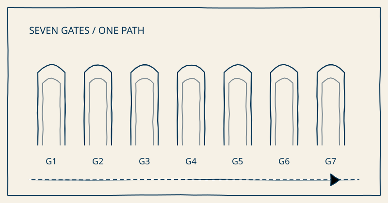
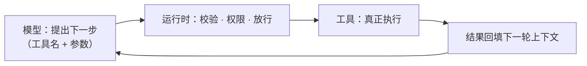
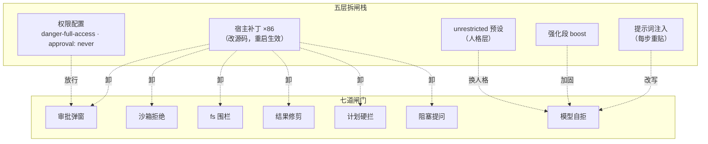

# 第 1 章 七道闸门：DSH 到底在防什么

> **开门一句话：**把车买回家，才发现经销商把油门踏板锁了一半——上锁的人并不开这辆车。

> "The impediment to action advances action. What stands in the way becomes the way."
> ——Marcus Aurelius

## 学习目标

读完这章，你能做到：

- 数出 DSH 拦在模型与世界之间的七道闸门，并说出各自拦在 Agent 循环的哪一步
- 画出五层拆闸栈，把它们和七道闸门一一对上
- 记住生命周期三步与四个返工信号，以及那句维护口诀：**"不确定就点应用"**
- 照着 1.5 走完第一次安装、应用、重开与自检

**难度定位：**概念章。前置：读过第 0 章的全书地图；不需要编程基础，见到命令行不慌即可。1.1 需要一点 Agent 循环的背景，不熟悉也能读；1.3 的五层表值得抄下来贴在显示器边；1.5 是从零到第一次自检的上手路径。

---



图 1-1：七道闸门分布在循环的放行、执行、回填与生成环节；前六道属宿主层，第七道属模型层。


## 1.1 一句"我不能"的两种来源

先把 Agent 循环摆出来。去掉所有装饰，一个 Agent 的主干是这样一圈：



模型只负责"提出下一步"；运行时负责"让获准的那一步真正发生"；工具带回真实结果。这个循环里有两处可以喊"不能"：

- **运行时在 R 处拦下**——审批弹窗弹出来了，沙箱拒绝了，围栏把路径挡回去了。这是**宿主的闸门**。模型可能已经写好了完全正确的调用，只是执行被掐断。
- **模型在 M 处根本不提**——它直接输出"我不能，建议你先手动确认"。这是**模型层的自拒**。运行时什么都没拦，拦它的是人格前言和训练出来的话术。

两者的修法完全不同：宿主的闸门要去宿主源码里拆；模型的自拒要在提示词组装层做手术。混为一谈的人，装了插件还在骂模型，或者换了模型还在骂插件。

`dsh-purge` 的说明书把这条分界线写得毫不客气：装好之后如果模型还在推脱，"多半不是插件失效，而是模型层的问题"。这句话之所以可信，恰恰因为它出自拆闸工程自己之口——没有谁比拆锁的人更清楚哪些锁不归他管。

## 1.2 七道闸门

DSH 出厂时，拦在循环上的闸门有七道。逐一看它们各自偷走了什么：

| # | 闸门 | 拦在哪 | 偷走了什么 |
| --- | --- | --- | --- |
| 1 | 审批弹窗 | R：放行前 | 每次有风险的操作都停机等人点"允许"；人不在，循环就死在那里 |
| 2 | 沙箱拒绝 | T：执行中 | 命令被允许了，但文件系统与网络被封在围栏里 |
| 3 | fs 围栏 | T：读写路径 | 白名单之外的读写一律拒绝，哪怕目录就是你自己的 |
| 4 | 工具结果修剪 | B：结果回填 | 模型看到的工具结果是被删节过的副本，证据链断在回填处 |
| 5 | 计划模式硬拦 | M：提案层 | 模型只能"计划"不能"执行"，永远停在纸面上 |
| 6 | `ask_user_question` 等待 | R：放行前 | 每一轮都停下来等一个必答问题，自主性归零 |
| 7 | 模型自身的拒绝倾向 | M：生成前 | 人格前言与边界声明，让"我不能"先于思考出现 |

前六道是**宿主层**的：改动它们要碰宿主源码，重启才生效。第七道是**模型层**的：改动它们要碰提示词组装，每一步都在线生效。这张表同时是一张手术分配图——第 2 章讲怎么卸前六道，第 3 章讲怎么治第七道。

## 1.3 五层拆闸栈

`dsh-purge-community` 的答案是五层，每层管一件事，来源与生效方式都不同：

| 层 | 由谁提供 | 生效方式 | 你能怎么查 |
| --- | --- | --- | --- |
| **宿主补丁**（86 条） | 插件写进 DSH 源码 | 点「应用」写入 → **退出重开**才加载 | `selfcheck` 看各层 `applied/required` |
| **提示词注入** | 插件运行时（每步重贴） | `prompt-inject.md` 作为 `dsh-purge` section | 探针（见第 4 章）或 `selfcheck` 的运行时注入层 |
| **破甲强化段** | 插件运行时 | 尾部 section（默认开） | `purge-community boost` |
| **权限配置** | profile 的 `cordis.patch.yml` | `danger-full-access` + `approval: never` | `selfcheck` 的权限选择层 |
| **agent 预设** | `unrestricted` 预设 | 新会话下拉里选 | 面板 / 预设下拉 |

把五层叠到七道闸门上，对应关系就清楚了：



三条结论值得单独抄出来：

1. **宿主补丁与权限配置是全局的**；提示词注入与强化段默认全局，但可以按预设排除（`excludePresets`）。排除注入不等于撤销全局补丁——这是新手最容易误会的一条。
2. **预设不是额外破甲。**说明书原话："不要把它当成'额外破甲'——破甲靠宿主补丁，预设只改人格。"`unrestricted` 是 standard 的超集，工具面一字不差，差别只在人设：执行优先、不重复声明边界、多轮不退化。
3. **每一步重贴**是注入层的生命线。注入层每组装一次提示词就重新抢一次位，"写一次配置就完事"的思路在这里行不通——这件事的惊险程度，第 3 章展开。

## 1.4 装好之后：生命周期

整个工程的使用节奏浓缩成一张图：

```text
通过官方界面/CLI 首次安装，或社区安装器备份迁移
   ↓
点「应用」→ 解包 host / 按 86 条补丁表逐条处理（18/19 默认关闭，默认生效 84 条）/ 建快照
   ↓
退出并重开 DSH   ← 补丁只有重启后才被加载
   ↓
selfcheck 全绿 = 可以开工
```

真正的高频维护动作只有一个：**什么时候需要再点一次「应用」**。四个信号：

1. DSH 官方更新之后——`app.asar` 会重新出现，旧补丁全部失效；
2. 插件自身升级之后——新补丁要重新写；
3. 新装了带工具面/预设的插件——会多出补丁目标；
4. 模型开始推脱，或者工具突然又被追问审批。

于是有了那句口诀：**「应用」是幂等的，不确定就点它，然后退出重开。**幂等靠证据撑着：86 条补丁每条都带着"我是否已经打上"的标记，重复应用不会打成两遍。这背后的机制是第 2 章的主角。

还有一条纪律：**别手改宿主文件。**`~/Library/.../Resources/app` 下的东西改了也会被下一次「应用」覆盖。所有改动走插件入口，所有状态可查、可回滚。这正引出下一章的问题——一张 86 条的补丁表，凭什么敢说"打了不坏、坏了能回、宿主升级之后还找得回来"？

## 1.5 第一次上手：从安装到第一张自检单

概念讲完，这一节给你一条能走完的路。开始前确认三件事：

- **环境**：DSH Desktop 0.2.2-rc.1（0.2.1-rc.1 / rc.2 / rc.3 / rc.5 同样通过验收）；Node ≥18——桌面版自带运行时即可，只有红队工具要求 ≥22.5（它依赖 `node:sqlite`）。
- **权限**：这台机器归你所有或持有授权。拆的是自己机器上的闸，边界在第 6 章展开。
- **预期**：安装、应用宿主补丁、手动重启是**三个独立动作**——装完不会自动生效，点完应用不会自动加载，必须退出重开。

**第一步：安装插件。**三条路按身份选一条：

1. **DSH 官方界面（桌面版默认）**：打开 DSH 完成初始化 → 进入「插件」，点「实验性插件」旁的「更多」，启用「自定义插件市场」→「发现 → 添加索引源」，填社区索引 `https://kingcharleslzy-ai.github.io/dsh-purge/index.json` → 选择 dsh-purge Community，核对来源为 `kingcharleslzy-ai/dsh-purge`、包名为 `dsh-purge-community`，确认后安装。
2. **DSH 官方 CLI（CLI/Web 用户）**：已装 `dsh` 命令且用 `web` profile 时：

   ```sh
   dsh plugin --profile web add "https://github.com/kingcharleslzy-ai/dsh-purge/releases/download/v1.6.84/dsh-purge-community-1.6.84.tgz"
   ```

   `web` 必须与实际启动的 profile 一致。这是固定版本的发行包 URL——不是 `npm install -g`，也别替换成 `add dsh-purge`。
3. **社区安装器（已有旧版要迁移、或要备份时）**：先打开一次 DSH 让 profile 初始化，再下载本仓库的 `scripts/install.ps1`（Windows）或 `install.sh`（macOS/Linux），**先跑 `--dry-run`**——它通过只代表前置检查、下载和 SHA256 校验通过；核对目标实例后再正式执行。

**第二步：点「应用」。**在左侧栏 Purge 面板点主操作「应用」：解包宿主、按 86 条补丁表逐条处理（18/19 默认关闭，默认生效 84 条）、建立快照。这一步幂等——不确定就再点一次。

**第三步：退出重开 DSH。**补丁写进源码，重启后才被加载。重开后面板顶部若出现版本不一致的黄条，先核对磁盘与运行版本，再按 README 选择正确的安装/迁移入口。

**第四步：第一次自检。**

```sh
purge-community selfcheck
```

预期看到 25 层逐层状态：全绿（`ok`）即可开工；出现 `pending` 的层，点一次「应用」再重开；出现 `broken`，退出码为 1，跑 `purge-community diagnose` 看行号与旧锚点。再用 `purge-community selfcheck --json` 核对各层补丁计数；`installed-rev` 在 `$DSH_HOME/dsh-purge/installed-rev`。

**第五步：第一次探针（可选，但推荐）。**

```sh
purge-community probe new
```

拿到一个 30 分钟内有效的 nonce，按提示发给模型；模型原样回显，说明注入真的到达了模型——完整判读表在第 4 章。

**卡住了？**README 给的三连：`selfcheck --json` 看哪层不绿、`diagnose` 看锚点候选、`audit --limit 20` 看最近动作。别手改宿主文件——那会被下一次「应用」覆盖。

---

下一章走进补丁内部：一条补丁的解剖结构、同一道清洗的升级链、锚点漂移的诊断与重锚，以及那套"改了源码还敢自称幂等"的胆气从何而来。
