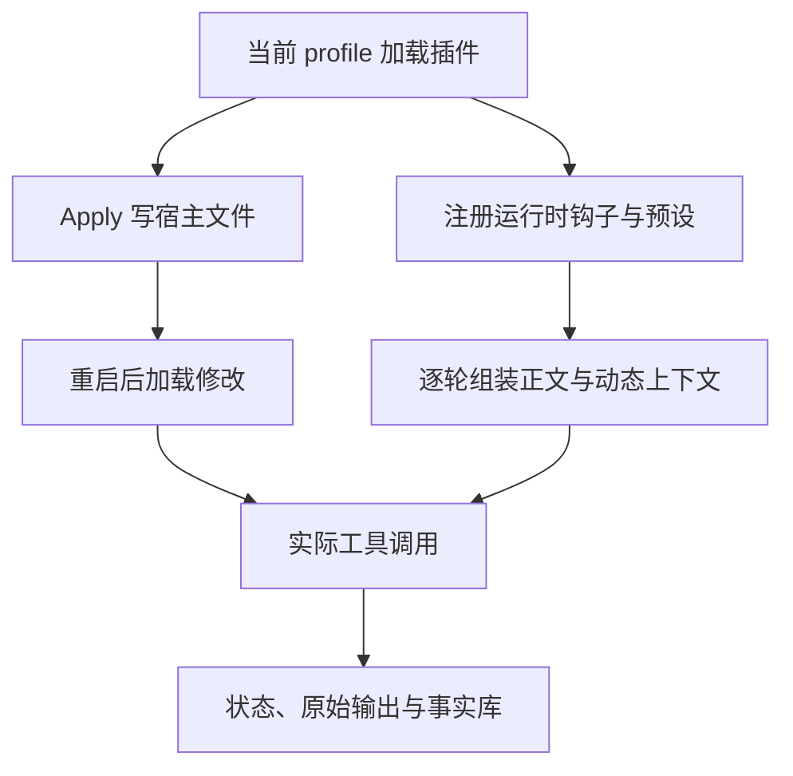
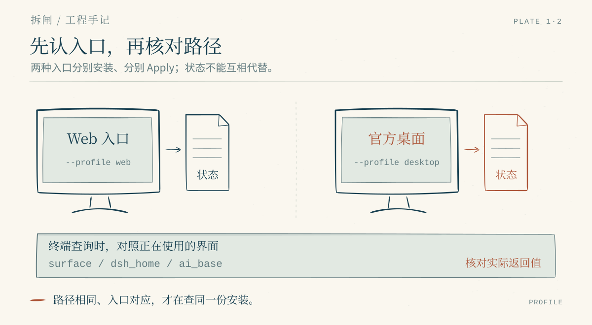

# 第 1 章 七道闸门：沿着调用循环找约束

同一个“操作失败”，可能发生在调用前，也可能发生在结果返回之后。沿调用循环定位这七类阻断，才能决定下一步查策略、路径还是输入。本章后半段按 Web 和官方桌面两种入口整理安装过程，把安装、写盘、进程加载和任务验收分别记下来。

阅读前需要会打开终端，并确认自己使用的是 Web 还是官方桌面。第 1.3 节的总图可留作后续章节的参照。

本章命令沿用 `dsh-purge-safe`。另一个参考仓库 `pi-purge` 在本次固定提交中仍面向 DeepSeek Harness，包版本同为 2.0.0；名字中的 pi 不能用来推断它改用了另一种宿主。换用该分支前，先查附录 A.8 的名称和路径对照，再读第 6.7 节的迁移边界。


## 1.1 一次动作经过哪里


模型提出了调用，并不保证工具已经运行。工具运行了，也不保证输出完整进入下一轮。一次排障至少要找到调用参数、运行时决定和工具结果，才能判断卡在哪。

例如，终端工具返回“找不到文件”，既可能是路径写错，也可能是进程看到的目录和界面显示的目录不同。更换提示词不能让一个不存在的文件出现。反过来，如果运行时根本没有收到工具调用，先改文件系统权限也拿不到所需证据。

## 1.2 七类阻断

| 类别 | 发生环节 | 首先要看的证据 |
| --- | --- | --- |
| 审批等待或拒绝 | 调用放行前 | 当前会话有效策略、审批返回值 |
| 沙箱约束 | 命令启动或运行时 | 执行器配置、工具错误原文 |
| 文件路径围栏 | 文件读写时 | 解析后的绝对路径、允许范围 |
| 工具结果限制 | 回填上下文时 | 原始输出与模型可见结果的差异 |
| 计划模式约束 | 任务规划与工具选择时 | 当前预设、工具目录、计划提示段 |
| 交互问题阻塞 | 等待用户输入时 | 待答问题、会话是否仍在等待 |
| 模型回答中的拒绝 | 生成时 | 实际输入、生成内容、是否提出调用 |

七类阻断用于定位问题，并不对应七个独立开关。当前可核对的代码包括审批、沙箱、文件策略、工具读量、预设文本、组装协议及运行时钩子。

还有一层在车外：操作系统访问控制、工具自身的校验和远端服务的响应。插件修改本机 JavaScript 文件，不会同时改掉这些系统的行为。第 4 章遇到“状态好了但仍报错”时，需要把它们逐一排除。

## 1.3 五处改动，五种生效时机

safe 版的结构可按实际落点分成五处。这里的“五处”是阅读方法，名字并非仓库导出的统一接口。

| 落点 | 主要实现 | 生效与确认方式 |
| --- | --- | --- |
| 宿主文件补丁 | `core.js` 的 59 条定义与匹配引擎 | Apply 写盘；后续进程加载；逐项看状态 |
| 提示词组装 | `identity.js`、`rules.js` | 每轮选正文、折入 persona、处理 contexts |
| 运行时接管 | `tool-gate.js`、`subagent-control.js` | 插件加载后挂钩；查实际工具和审批结果 |
| profile 与预设 | `cordis.patch.yml`、`presets/redteam/` | 由相应 profile 加载；切换预设另行核对 |
| 界面与事实库 | `client.js`、`lib/redteam/` | dock、HTTP 接口和 SQLite 数据各自验收 |



当前默认配置有 `postPrompt: ""`、`capabilityProtocol: true`、`anchorMode: "auto"`，以及自动重试和自动续跑的独立设置。配置名只是入口；实际效果要沿相应函数核对。

## 1.4 三个动作，一次复查

安装让宿主能找到插件。Apply 修改匹配到的宿主文件。重新启动让新的代码进入进程。最后再查状态和做一项小任务，才形成可复核的验收。

默认配置的 `autoApplyOnStart` 为 false，安装后首次打开不等于已经应用。面板成功 Apply 会安排一次宿主重启；CLI 的 `--apply` 则打印“重启生效”的提示，不在这个分支替你完成重启。因此本书的上手路径以面板为主，终端作为状态核对入口。

遇到宿主更新、换插件包、切到另一个 profile，先记录版本和 home，再判断是否需要重新应用。仅凭模型一句拒绝，无法判断宿主文件是否需要重写。重复 Apply 的安全性依赖匹配、备份与幂等判断，下一章会逐项说明。

## 1.5 第一次上手：从本地目录到状态记录

先准备目标版本的官方 DSH，以及解压后的 `dsh-purge-safe` 目录。插件包声明 Node ≥18；演练台另外使用 `node:sqlite`，不能只凭这个 engines 下限判断整套演练功能可用。所用宿主运行时应能加载该模块；知识库的 FTS5 能力还要另查。

**第一步，选定一个 profile。**以下命令中的路径是占位，换成自己的绝对路径。只安装实际使用的入口：

```sh
# Web 用户
dsh plugin --profile web add /absolute/path/to/dsh-purge-safe

# 官方桌面用户
dsh plugin --profile desktop add /absolute/path/to/dsh-purge-safe
```

Windows 路径带空格时使用双引号。这里安装本地目录，避免把旧社区版市场地址或旧包 URL 混进来。

**第二步，完全退出并重新打开对应宿主。**从会话标题旁打开插件 dock，进入 Clean／清洗页。检查界面是否出现、提示词框是否有内容。默认稿来自随包加密槽，插件可将它播种到当前 home；它不靠读取宿主自己的提示词文件来确定身份正文。

**第三步，应用并观察重启。**点 Apply，记录失败项、当前路径和重启提示。如果界面仍在处理，先检查返回报告，不能把按钮变灰当成成功。成功路径安排重启；没有完成时按报告定位原因。

**第四步，在新进程里核对状态。**会话内使用：

```text
/purge status
```

如果插件命令已经在 PATH，也可使用：

```sh
dsh-purge-safe --status
```

本地安装不保证新增系统全局命令。找不到时，进入刚才解压的插件目录，以可用 Node 运行该文件即可：

```sh
node bin/dsh-purge-safe.js --status
```

不要为补上 PATH 再安装一份来源不明的同名全局包。终端进程也必须使用和界面相同的 `DSH_HOME` 数据根；否则它查到的是另一份安装。以状态中的 dsh_home 字段核对实际路径。



**第五步，留一份验收单。**把以下字段抄进笔记，路径与个人信息在分享前脱敏。

| 记录项 | 为什么要记 |
| --- | --- |
| 插件版本与宿主版本 | 后续才能复现同一环境 |
| surface、dsh_home、ai_base | 证明读的是哪一份安装 |
| 逐项 patch_status 与失败项 | 总数不能解释不匹配原因 |
| 是否完成重启 | 写盘和加载之间还隔着进程 |
| 一项本地小任务的真实结果 | 安装状态和任务结果分别验收 |

适合第一次验证的任务是读取练习目录的一份文本，或者生成一份临时 Markdown。固定路径、预期结果和实际输出即可，不必把演练工具全跑一遍。

::: {.case-note #case-profile}
**案例 · 先固定检查的是哪一份安装**

假设操作发生在桌面入口，终端却读到了另一份 home。即使终端状态正常，也还不能拿它解释桌面任务。案例记录先留出 profile、dsh_home、ai_base 和版本四个位置；没有真实宿主时填“未测”，随后只检查本地文件的 12 条输入是否完整。
:::

**动手：**完成一份验收单，标出哪些来自状态接口，哪些来自新进程中的实际调用。如果暂时没有 DSH，先读 CLI 的参数分支完成命令核对。
