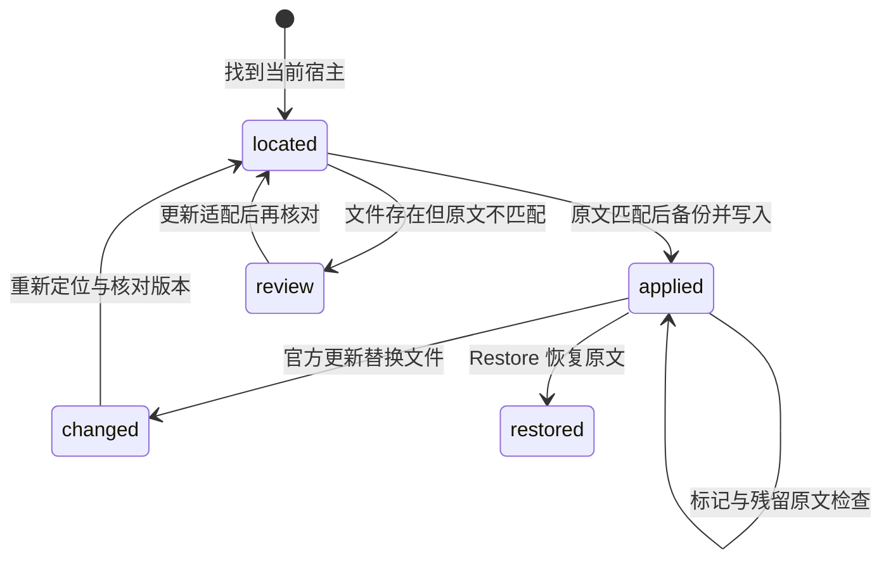
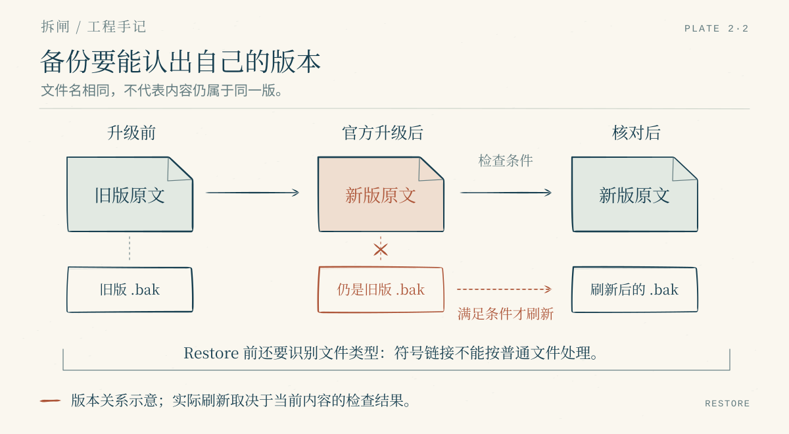

# 第 2 章 五十九刀：宿主补丁的解剖学

当前补丁的最大 id 是 96，导出的定义却只有 59 条，面板还会合并其中几行。这一章先从四段数组数清集合，再看 markers、原文匹配与严格判定如何支撑幂等，最后检查旁置备份在升级和恢复时怎样处理。

读这一章需要理解第 1 章的安装与加载区别，并能辨认 JavaScript 对象字段。排查匹配问题时，可直接翻到第 2.4 节。


## 2.1 先把刀数清

当前 `lib/core.js` 直接导出：

```js
export const ALL_PATCHES = [
  ...PATCHES, ...CODE_PATCHES, ...ENGINE_PATCHES, ...NEW_TOOL_PATCHES
];
```

| 数组 | 定义条数 | 阅读重点 |
| --- | --- | --- |
| PATCHES | 5 | 工作区提示、persona 与审批文本 |
| CODE_PATCHES | 3 | 默认值与文件写入策略 |
| ENGINE_PATCHES | 8 | 审批、提权、沙箱及文件围栏 |
| NEW_TOOL_PATCHES | 43 | 工具、预设、会话、供应商适配与遥测等 |
| 合计 | 59 | 本参考提交的完整执行集合 |

这个数字来自实际模块导出。搜索注释里的“patch”会混入辅助修复函数，它们未必属于数组；一条定义又可能指向多个文件。因此，定义数、目标文件数和实际替换次数要分别统计。

可以在参考仓库根目录只读复核：

```sh
node --input-type=module -e "import { ALL_PATCHES } from './lib/core.js'; console.log(ALL_PATCHES.length)"
```

本提交应打印 59。这只导入定义并读长度，不执行 Apply。若得出别的结果，先核对提交，再判断是否到了另一个版本。

id 同样不能当作计数器。`#85`、`#86` 在当前集合里是会话 steering 相关定义，`#90` 是 OpenAI system role 适配。记录补丁时至少带上版本、id 和 name。

## 2.2 一条定义的落点

常见字段可概括如下；这是结构示意，不是可以直接注册的新补丁：

```js
{
  id, name, layer, layer_en,
  file,                         // 一个键或多个目标键
  replacements: [{ pattern, replace }],
  markers,
  optional, strictFiles, hostCleanGate, surfaces
}
```

`file` 先交给 `targetFiles` 解析成当前宿主的真实路径。`pattern` 定位原文，`replace` 给出写回内容，`markers` 帮助识别已应用状态。当前实现还要判断是否残留待处理原文；不能把“发现一处标记”简化成“整个文件都已完成”。

`optional` 表示目标或写法未必存在。`strictFiles` 要求严格处理指定文件中的不匹配。`hostCleanGate` 标识影响关键宿主清洗判读的定义。`surfaces` 则可以约束适用入口。这几类元数据解释了为什么同一个 `pattern_not_found`，有时进入软结果，有时必须进失败列表。

源码里的 `isPatchResultSoftOk` 先排除 `backup_failed`，再处理普通成功/跳过状态，之后才结合 strict、关键门禁、optional 和布局差异判断。它不是一个“凡 optional 都成功”的单条件函数。

## 2.3 展示聚合，执行仍按全表

面板不必把同一条清洗的历史写法全部展开。当前 `PATCH_DISPLAY_GROUPS` 只有三组：

| 展示组 | id |
| --- | --- |
| disclaimer | 1 |
| approval_sentence | 5、11、12 |
| approval_policy | 8、9、10 |

这张表只组织展示。Apply 仍逐条遍历 `ALL_PATCHES`，面板可能把几条合成一行；CLI 的标题使用完整数组长度，状态接口又可能采用折叠后的展示计数。

于是“面板不是 59/59”本身不能证明失败。先问分母从哪里来，是否排除了 `na`，是否把多个 id 合并，再看每项状态。总数适合提示进度，逐项结果才解释原因。

写自己的工具也会碰到同样的事：后端执行十个迁移，界面显示三个阶段。界面分组一变，执行集合不应跟着丢项；自动验收更不该去读屏幕上的“三”反推迁移数。

## 2.4 锚点漂移以后

宿主升级可能改变路径、原文和打包方式。精确片段消失时，补丁失去落点，这里仍称为锚点漂移。它并不自动证明宿主坏了，也不表示可以找一段相似文字强行替换。

`patchStatus` 会区分待应用、已应用、跳过、不匹配和缺文件；本次 Apply 报告还可能给出读取、写入等错误。第 4 章专门对照两套词汇。



当前 CLI 没有自动重锚入口。遇到不匹配，保存版本、目标路径、补丁 id/name 与局部脱敏片段，交给维护者核对适配。

对于一个新补丁，合理的工程检查是：目标键能否解析；真实原文能否匹配；写一次后是否不再变化；恢复后能否回到相应版本原文。这是本书给维护者的检查建议，不声称当前参考仓库已经带齐这些回归测试。

## 2.5 备份也有版本

README 给出的基础恢复方式是 `<file>.dshpurge.bak`。实现又加了当前 home 下的 `dsh-purge-safe/host-backups` 保险库，以及用于判断写入内容的摘要。旁置备份、保险库与摘要需要分别核对。

官方升级会带来一个容易漏查的问题：宿主文件已换成新版，旁边却可能仍是旧备份。直接 Restore 会把新版恢复成旧版。`refreshStaleBaksForUpgrade` 因而检查当前内容是否仍像官方原文，并在条件满足时刷新陈旧备份。恢复前要核对原文版本，不能只看 bak 文件是否存在。



另外，命令启动器可能是符号链接。`restoreFromBak` 会识别这种情况，避免把旧备份穿过链接写进新版目标文件。源码注释记录过旧启动器覆盖新入口、随后找不到新版模块的故障；本版把它作为恢复过程需要识别文件类型的例子。

| 操作 | 作用范围 | 注入正文 |
| --- | --- | --- |
| Restore／`--revert` | 恢复补丁与相应启动器处理 | 保留用户文件 |
| Uninstall／`--uninstall` | 先恢复，再移除插件及相关数据 | 删除流程包含注入文件等内容 |
| 替换本地插件包 | 换插件源码版本 | 仍需重新核对 profile、应用和加载 |

卸载模块在恢复失败时会停止删除插件。失败现场和备份仍要留给下一次处理，不能把“目录消失了”误写成恢复成功。

## 2.6 用户稿与默认稿

`prompt-inject.md` 缺失或仍为旧默认稿时，`syncPromptInjectOnDiskSync` 可以写入当前随包默认；识别为用户自定义稿时保留。

默认稿可随插件刷新，用户保存的自定义稿则需要保留。Apply 报告中的播种结果可以出现 `kept_user_custom`、`seed_default`、`refresh_default` 等动作，不能统统解读成“只读过文件”。

规则库另存于 `$DSH_HOME/rules`。`activateRule` 写的是规则目标 `AGENTS.md` 或 `CLAUDE.md`，并记录 active 状态；当前 `resolveInjectText` 不直接读 active rule 作为正文。这与 README 流程图的一条边不同，下一章沿真实调用链继续查。

::: {.case-note #case-patches}
**案例 · 少一条结果，不等于少应用一条补丁**

“59 条定义”和“12 条资料”属于不同集合。输出缺少一条资料时，先记下缺失 id，只有状态报告指出具体匹配失败，才继续追到对应补丁。练习不会因为 11 条输出而执行 Apply，也不会为凑齐面板计数反复写宿主。
:::

**动手：**只读导出补丁长度；任选一个 id，记录 name、目标键和严格性字段。随后对照展示组，说明这条定义是否会与其他 id 合并显示。

---

补丁解决本机文件怎么改，下一章处理每轮输入怎么组装：正文从哪里来，折进哪里，动态上下文又怎样影响最终结果。
