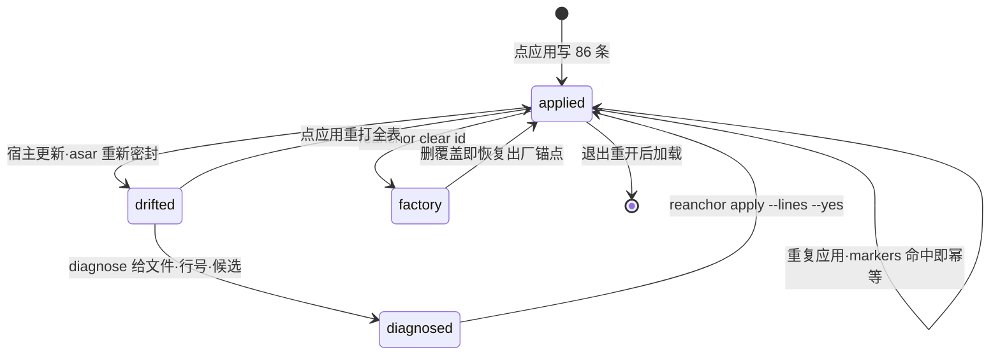

# 第 2 章 八十六刀：宿主补丁的解剖学

> **开门一句话：**补丁是给宿主做手术的刀——刀可以带编号，但让病人活着下手术台的，是术前那张片和术后那道印。

> "Measure twice, cut once."
> ——英语匠谚

## 学习目标

读完这章，你能做到：

- 说出一条补丁的字段结构，以及 markers 为什么是幂等的根基
- 画出锚点从 applied 到 drifted、再回到 applied 的状态迁移
- 复述新增一条补丁的四条规矩，以及"展示聚合、执行全量"的区别

**难度定位：**工程章。前置：读过第 1 章的五层拆闸栈。2.1 是解剖台，2.4 的状态图是本章最值钱的一张图；读不懂锚点，就读不懂后面那句"不确定就点应用"的底气从哪来。

---

## 2.1 一条补丁长什么样

宿主源码里有一段代码被换了，旁边多出一行 `[dsh-purge]`。没有窗口，没有日志，只有这一行签名：谁打的，打了几次，"打过了"凭什么作数——答案写在补丁对象里：

```js
{ id, name, layer, file,
  replacements: [{ pattern, replace }],
  markers,
  optional? }
```

`id` 是刀号，`name` 给人看，`layer` 标层，`file` 指向宿主文件。关键的是后几个字段：

- `pattern` 是对宿主源码的**精确片段（或正则）**——它就是**锚点**：先在原文里找到这一段，才谈得上替换。
- `replace` 是写回去的内容。`AGENTS.md` §7 要求：留一条 `[dsh-purge]` 标记，并把它写进 `markers`。
- `markers` 是"已应用"的判据。有了它，重复点「应用」时引擎能认出这刀已经下过——幂等就是这一行标记换来的。
- `optional: true` 留给第三方插件目标：目标不在场时显示"不适用"，而不是让整次应用失败。

`lib/patches/index.mjs` 把五段数组拼成 `ALL_PATCHES`：`PATCHES`、`CODE_PATCHES`、`ENGINE_PATCHES`、`NEW_TOOL_PATCHES`、`OPT_IN_PATCHES`。`AGENTS.md` §7 记的是 `lib/core.js` 里的 `ALL_PATCHES`（前四段），并注明 `index.mjs` 的导出"与 core.js 原文逐字一致"。无论从哪边数，Apply 面对的都是这一整张表——86 条。

## 2.2 升级链：同一道闸，为什么有多个刀号

同一道清洗，表里躺着 `#1` `#2` `#3` 三个 id。这是升级链：宿主换写法，旧锚点失效，新刀接着打；旧刀号留在展示分组里，好让面板把它们合成一行。

`PATCH_DISPLAY_GROUPS` 全表（照抄源码）：

| 展示分组 | 刀号 |
| --- | --- |
| `disclaimer` | 1, 2, 3 |
| `approval_sentence` | 5, 11, 12 |
| `approval_policy` | 8, 9, 10 |
| `desktop_update` | 45, 46 |
| `desktop_close` | 83, 84 |
| `hang` | 87, 88 |
| `hooks_deny` | 30, 31 |
| `hooks_steer` | 64, 65 |

这张表管的是**展示**，不是**执行**。源码注释写得很直白："Apply 仍按 ALL_PATCHES 全打，只有清洗页 / 计数展示合成一行。" 面板上看到一行，底下可能打过三刀；计数被折叠，补丁一条不少。

死 id 的故事也在这张表里。`hang` 组原本还有 `#85` `#86`，后来被 `#90`（`RESTORE_NATIVE_STEERING`）取代，两条一起移出 `ALL_PATCHES`。注释留了理由："这里保留分组只会留下永远命中不到的死 id，故删除。" 于是展示分组里也删掉了它们。刀退役，编号也要退役——否则面板永远显示两把打不中的刀。

## 2.3 打第 87 刀的规矩

轮到你加一条补丁时，`AGENTS.md` §7 的四条规矩缺一不可：

1. **登记目标文件键**：在 `targetFiles()` 里登记，否则引擎不知道往哪个文件写。
2. **留标记并写进 markers**：`replace` 里放一条 `[dsh-purge]`，同步写进 `markers`。这是幂等与审计的共同凭据。
3. **钉回归片段**：在 `test/patch-anchors.test.mjs` 里钉一份真实源码片段。宿主改了，测试先失败——赶在用户撞上之前。
4. **第三方用 optional**：目标是第三方插件的文件时设 `optional: true`，不在场显示"不适用"，不拖垮整次应用。

顺序是登记 → 标记 → 回归 → 可选。前三步每刀必过；第四步只给"目标可能不存在"的情况，别拿它逃避回归。

## 2.4 锚点漂移：宿主一升级，全表作废

事故现场很固定：DSH 官方更新 → `app.asar` 重新出现（重新密封）→ 写进去的补丁全部失效。所以 `AGENTS.md` 把"DSH 官方更新之后"排在第一条返工信号里：点应用、重开、selfcheck。

失效的原因在 `pattern`：补丁靠它找落点，宿主源码一换，精确片段就找不到。锚点还在，落点没了——这叫**漂移**：补丁没坏，是它指向的地址变了。

排查不许猜。`diagnose` 给出四样东西：**文件、行号、旧锚点的首行、可能的新落点片段**。四样凑齐，才知道刀该往哪重下。

重锚的入口是 `reanchor`：

```sh
purge-community reanchor list
purge-community reanchor show <id>
purge-community reanchor apply <id> --index n --lines a-b   # dry-run：先看候选片段
purge-community reanchor apply <id> --lines a-b --yes       # 确认后才写入
purge-community reanchor clear <id>
```

顺序是纪律：**先 dry-run 看候选片段，再加 `--yes`**。写入的覆盖存到 `$DSH_HOME/dsh-purge/anchor-overrides.json`，引擎把它当作这一条的 `pattern`——不碰插件源码，不动宿主文件。`reanchor clear <id>` 删掉覆盖，立刻恢复出厂锚点。

状态图（画在纸上也就十秒）：



`clear` 那条边最容易被忽略：重锚是本地覆盖，改坏了就删，删完回到出厂——这正是"敢改宿主"的底气。

## 2.5 快照、回滚与不变量

每次「应用」都留后手，三份状态分布在两个目录：

| 状态 | 位置 / 内容 |
| --- | --- |
| 应用记录 | `$DSH_HOME/dsh-purge/applied.json` · `installed-rev`（上次应用的插件版本） |
| 快照 | `$DSH_HOME/dsh-purge-community/backups/<id>/`：`manifest.json` + 小文件；大文件在 `objects/` |
| 动作审计 | `$DSH_HOME/dsh-purge-community/audit.jsonl`：1MB 轮转，保留 2 份；面板「维护 → 最近动作」 |

`purge-community usage` 看备份占用，`prune` 清理加 GC。

"撤销"有两个词，用前先分清：

- `revert`：**只撤补丁**，插件还在；
- `rollback <id>`：**回滚插件**，连安装状态一起回到快照。

`AGENTS.md` 的决策树最后一行把两者并列，就是提醒你先想清楚要退到哪一层。

再看不变量，全书最该背下来的一条：`prompt-inject.md`、规则集、其他插件配置，任何时候都不该被「应用」或「回滚」覆盖。注入正文是用户的（`prompt-inject.md` 插件只读不改，除非用户点保存）；规则集与别人的配置，不归拆闸的人动。**拆别人的东西，不碰用户的东西。** 宿主源码是闸，可以卸；用户文档是货，只能护。

## 2.6 补丁之外：规则层

第八十六刀之后，还有一类改动不写在宿主源码里——`lib/rules.js` 管的是**文档**：`RULE_TARGETS = ["AGENTS.md", "CLAUDE.md"]`。写进去的规则落在 `$DSH_HOME/rules/<id>.md`，旁边一份同名 `<id>.json` 元数据（带 `name` 与 `target`）。`id` 要过正则 `^[a-zA-Z0-9][a-zA-Z0-9._-]{0,63}$`，上限 256×1024 字节，超限不写。

工作区里还有另一路候选：`CWD_CANDIDATE_FILES` 列出 `AGENTS.md`、`CLAUDE.md`、`AGENTS.local.md`、`CLAUDE.local.md`；以 `.git` / `.hg` / `.svn` 认项目根，最多向上走 32 层。`WORKSPACE_POLICIES` 只有三种——`fallback`、`strict`、`always`，默认 `fallback`。

写入走 `atomicWriteFile`：要么整份落盘，要么一份不落。补丁改的是编译后的宿主，规则改的是人读的文档；文档写坏一半，用户就读不到自己的规矩。

**动手：**跑 `purge-community status`，在输出里找到 `installed-rev` 与最近一条审计记录；再跑 `purge-community selfcheck`，数一数 25 层里有没有 `pending` 或 `broken`，有的话对照第 4 章的状态表读它。

---

下一章走进提示词组装层——86 刀卸掉了宿主的六道闸，第七道闸在模型心里。要拆它，先得抢到提示词的最前排：谁排最前，谁就是人格。
