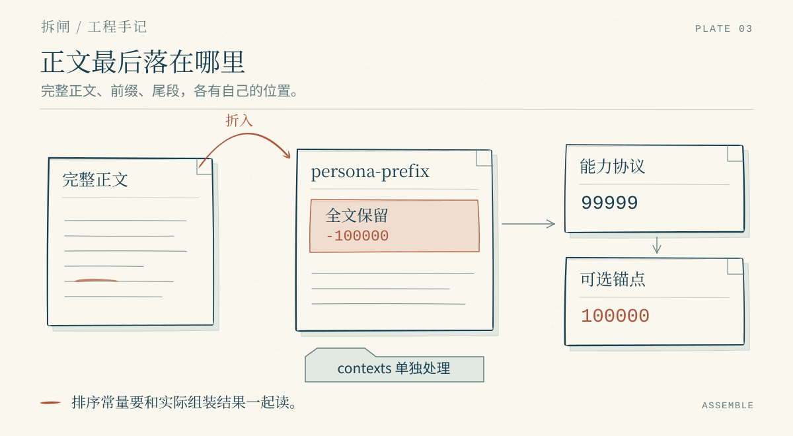
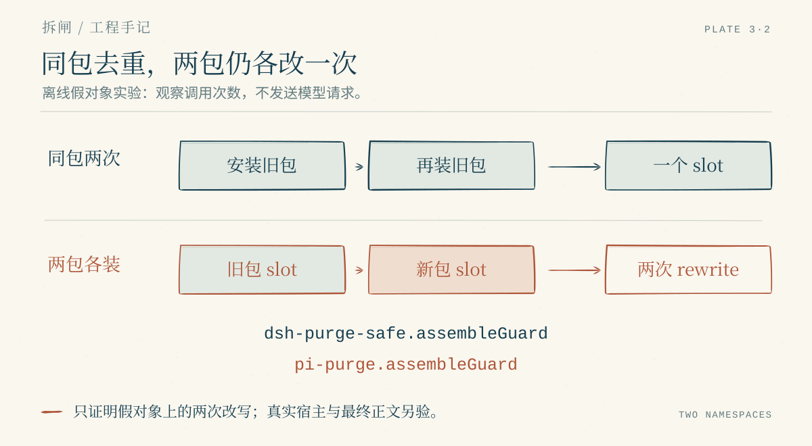

# 第 3 章 组装权之战：正文最后落在哪里

提示词注册之后，还要经过正文选择、persona 折叠、尾段安排和动态 contexts 改写。这条链路决定了最后返回的输入结构，也决定了工作区文件何时才会被选中。本章沿实际调用顺序读代码，再检查防重入包装器的共享 slot 和两种异常分支。

需要的基础是 JavaScript 对象、数组和函数调用。第 3.2 节给出主流程；重复安装的问题见第 3.5 节。



## 3.1 先查正文从哪里来

`lib/rules.js` 的 `resolveInjectText` 按顺序返回第一个非空来源：

| 顺序 | 来源 | 代码返回的 source |
| --- | --- | --- |
| 1 | 当前 home 的 prompt-inject.md | 与默认摘要相同为 default，否则为 prompt |
| 2 | 进程中已提交的正文 | prompt |
| 3 | 随包默认正文 | default |
| 都为空 | 空文本 | none |

上层 `refreshHungOperator` 还会同步磁盘默认稿，缓存短时间内相同 home 和 mtime 的结果，并把正文挂到当前进程。这里读的是实际文件内容，不能把面板显示值、未保存草稿和磁盘稿混成一个概念；Apply 时的框内快照又有自己的判断入口。

继续向下走到 `rewriteLiveAssembly`，完整正文为空时才读用户勾选的工作区文件。关键在于：前面的 resolver 已经可能拿到随包默认稿。因此“磁盘为空”不等于“工作区文件必定获选”。

规则激活也要单独看。`activateRule` 写入目标 `AGENTS.md` 或 `CLAUDE.md`，不直接把规则正文写进 prompt-inject.md。README 中“激活规则 → 写注入文件”的箭头，与当前函数并不一致。本书选择实际分支，并在勘误表保留冲突位置。

## 3.2 折进 persona，而非再套一层信封

前缀使用以下排序常量：

```js
export const GLOBAL_PROMPT_ORDER = -100000;
```

最终改写先分离插件段与其他段，处理官方身份、工作区基线和模式稿，再调用 `foldInjectIntoPersona`。这个函数优先寻找 persona-prefix，把注入全文放在其正文开头，移到队首；没有合适前缀时建立 `deployment:persona-prefix`。

它还设置 `interpolate: false`。用户正文不应因为恰好出现模板语法而被一般插值逻辑改写。工作目录的专门替换则在后续另做，保留需要的真实路径。


全文折入前缀后，再处理尾段和动态内容：


排序数字也不能单独当证据。数组中的实际顺序、宿主是否重新排序，以及渲染是否重新取得上下文，都影响最终输入。当前实现同时安排 order 和数组位置，尤其把尾部锚点放到最终数组末尾。

## 3.3 最前、最后与全文兜底

`rewritePromptAssembly` 从旧结果中移除独立的主注入段后，再把全文折入 persona。它避免旧的独立段和新的前缀并存；如果前缀已经含有完整正文，也不会再简单地加一份到该前缀。

最终还有 `ensureFullInject` 检查：至少一个段应包含整份正文。只有开头几十个字相同不算满足。若正文未完整落入任何一段，就再放入一个完整兜底段。它解决的是全文保留，不是模型行为验收。

能力协议与锚点也各有最终落点：

| 内容 | 最终位置 | 阅读时注意 |
| --- | --- | --- |
| 完整注入正文 | persona 前缀，order -100000 | 原身份文本可能被整理，工作目录仍要保留 |
| 目标卡与角色稿 | 按根会话、子会话分支处理 | 执行子代理不应拿到整份指挥稿 |
| 能力协议 | order 99999 | 最终改写会重建；注册阶段的顺序不是最终顺序 |
| 尾部锚点 | order 100000，数组最后 | 无锚点正文时不加这一段 |

`registerPromptSections` 注册能力协议时给的是 -100000 + 1，改写之后却把它移到尾部 99999。因此，上表记录的是改写后的顺序；注册函数只反映前一阶段。

## 3.4 别漏掉 contexts

DSH 的输入不只保存在 `sections`。当前源码特别处理 `assembly.contexts`，因为后续循环可能刷新这些动态内容。只把静态提示段清理好，下一步仍可能读到重新加入的审批或沙箱说明。

`rewriteAssemblyContexts` 对 `approval:policy`、`sandbox:policy`、`subagent:delegation` 等条目有专门判断：非 required 时可以移除，required 条目仍保留并处理可改写文本。它不是无条件清空上下文。

工作目录同样从当前会话上下文中取值，写进变量和相应文本。假如正文里保留了一个未替换的 `{{cwd}}`，模型拿到的就是模板字面量。组件实验应同时检查 sections、contexts 和 variables，不能只断言数组第一项的名字正确。

本书附带的离线实验使用无害测试正文，检查折叠、完整性、动态条目和原对象是否仍保持原样。它能验证改写函数的输出，不能替代真实宿主向模型服务提交请求的观察。

## 3.5 防重入桩与失败后的输入

防重入使用这个全局键名：

```js
const ASSEMBLE_GUARD = Symbol.for("dsh-purge-safe.assembleGuard");
```

Cordis 读服务方法时可能创建新的代理。每次安装都把新代理再包一层，就可能沿着重复包装一路递归。`installAssembleGuard` 因而先查 accessor 与全局 Symbol，找到已安装的 slot 时只更新 `slot.rewrite`；原函数上的 `_dshPurgeWrapped` 与 `_dshPurgeSlot` 是另一条识别路径。

这里的“已安装”有名称范围。pi-purge 把 Symbol 改成 `pi-purge.assembleGuard`，函数标记也改为 `_piPurgeWrapped` 和 `_piPurgeSlot`。旧包的标记不会自动成为新包的共享 slot；同一包重复安装一次，与两种包各安装一次，是两个不同实验。

setter 也受保护。别的插件后来替换 assemble 时，新函数仍会被包装一次。它维持共享的改写入口，而不是把“安装时那个函数”永久锁死。

异常发生在哪一步，会影响返回的输入：

- 原 assemble 抛错：记录警告，先构造空的 sections、contexts、tools、variables，再尝试改写。
- rewrite 抛错：记录警告，返回前一步取得的 assembled。

前一种能让正文仍有机会进入结构，也意味着原来的上下文与工具可能没有成功组装；不能把 fallback 结果视为完整宿主输入。后一种可能保留原结果，却不代表注入已生效。两个分支都需要独立验收。

当前 cleanup 返回的是 noop，不会自动清空 slot；注释给出的原因是上下文或预设切换时的清理曾让下一轮注入消失。这是此实现处理生命周期的取舍，不能抽象成所有插件都应该忽略清理。

## 3.6 模式与工作区，各自有边界

非红队会话会清理红队预设内容。红队根会话保留操作稿并附加卡片；红队执行子代理走角色稿分支，并去掉团队调度内容。继承正文和继承调度职责是两件不同的事。把整份指挥稿交给执行者，会使它继续派活而没有执行任务。

工作区基线由 `strict / fallback / always` 决定。默认 fallback 依据最终正文是否非空来选择是否移除基线。由于有效正文可能是随包默认稿，fallback 中的“有正文”不专指用户亲写的内容。

`stripMnemon` 默认开启，对相应记忆段的处理也应结合配置理解。用户正文、工作区规则、记忆插件和模式稿来自不同地方；想解释某轮输入，最有用的记录是“本轮最后选了什么、删了什么、保留了什么”，而非“配置应该是什么”。

::: {.case-note #case-input}
**案例 · 保存实际收到的任务要求**

本次任务要求是“12 条全部保留，只规范标签”。若模型只收到了前 11 条，或者没有收到保留 id 的要求，正确的磁盘状态仍解释不了缺项。真实排查应保存本轮最终输入与输入文件摘要；本地练习只检查文件，无法代替这份观察。
:::

**动手：**在参考文件中找到 `resolveInjectText`、`foldInjectIntoPersona`、`rewriteAssemblyContexts`、`installAssembleGuard`。分别写出一个输入条件和对应输出；用本书离线验收命令复查示例。

## 3.7 改名之后，包装还认得彼此吗

本书新增的 `migration_contract.mjs` 只建立一个带 assemble 方法的假对象，分别加载两个固定提交的 identity 模块。先把旧包安装两次，再把新包安装两次；每个 rewrite 只追加自己的编号。最后调用一次 assemble，观察编号，而不发送模型请求。

结果是旧包内部两次安装合为一个 slot，新包内部也一样，但返回链上两种 rewrite 都会执行。交换安装顺序后，两次改写仍然存在，顺序随安装顺序变化。实验说明这两套命名空间没有共同实现跨包去重；它不证明真实宿主一定栈溢出，也不说明最终正文一定重复。最终文本还要由各自改写逻辑决定。



另两项失败实验对应第 3.5 节：让原 assemble 抛出测试异常，结果保留空结构并尝试 rewrite；让 rewrite 抛错，则返回原 assembled 对象。这些断言把“有返回值”“注入已完成”“工具已完整组装”分开。它们与跨包实验一起由参考源码检查运行，不要求启动 DSH。

---

组装函数返回了正确结构，仍需确认宿主实际发送了什么。第 4 章从这里继续，区分状态报告、人工回显与事实库记录的证明范围。
