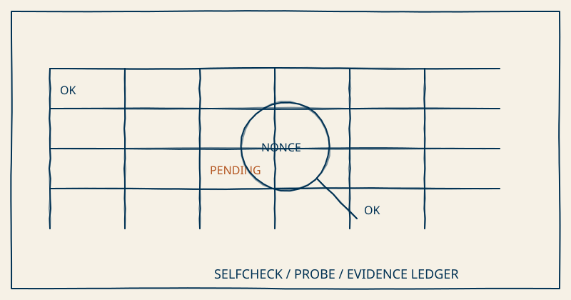
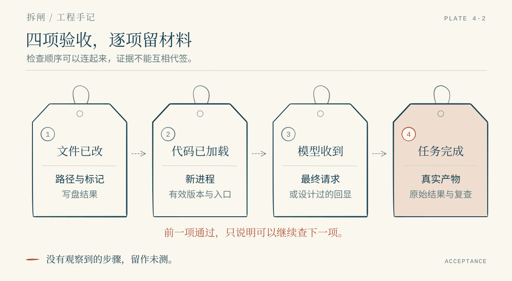
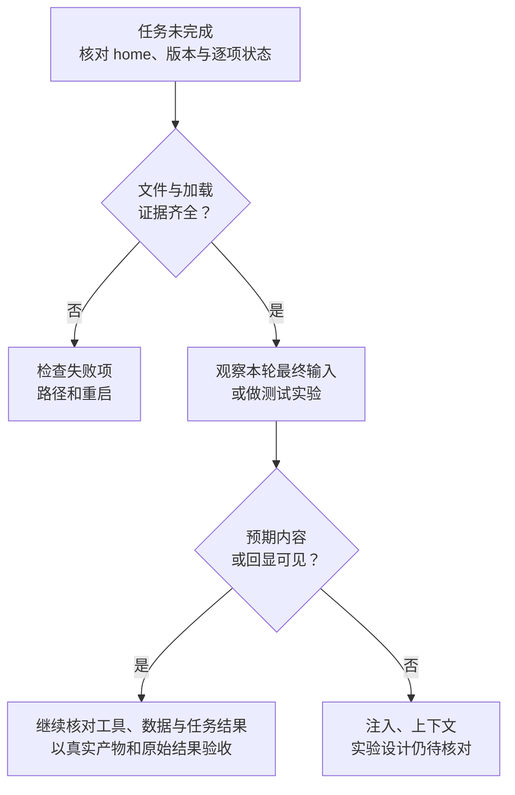

# 第 4 章 证据账本：状态之后还要查什么

状态显示正常，任务却没有完成，该继续查哪里？先分清磁盘查询和本次 Apply 报告，再分别确认文件、进程、输入与产物。本章也给出一个人工回显实验，说明它能支持哪些判断、还缺哪些证据，最后把任务回报连回原始记录。

前两章的补丁集合与组装链是这里的基础。核对时同时保留状态报告、观察条件和原始材料。

## 4.1 状态表和应用报告不是同一张表

当前 CLI 的只读入口是 `dsh-purge-safe --status`；会话里用 `/purge status`。CLI 打印宿主、home、目标文件、备份、注入状态、逐项补丁与 shim 信息。输出为文本，没有实现 `--json` 参数分支。

面板状态接口是 `/dsh-purge-safe/status`。它暴露更多宿主控制字段，并可能采用折叠后的展示计数。与它不同，点击 Apply 返回的是本次处理报告；刚发生的读取失败或写入失败，要在这份报告中找。

| 来源 | 常见词汇或字段 | 能说明什么 |
| --- | --- | --- |
| 磁盘状态查询 | applied、pending、skipped、unmatched、missing_file、na | 当前文件与定义的匹配情况 |
| Apply 逐项结果 | applied、already、pattern_not_found、missing_file、read_error、write_error 等 | 此次写盘尝试发生了什么 |
| Apply 汇总 | complete、host_written、failed、failed_items | 完成条件与失败明细 |
| 重启相关 | restart_after_apply、restarting、needs_full_quit | 安排或需要的后续动作 |
| 入口定位 | surface、process_surface、dsh_home、ai_base | 查询和执行指向哪份宿主 |

`ok: true` 不等于 `complete: true`。当前 Apply 返回对象把它们分列：请求可以进入正常报告流程，同时仍有失败项。读取报告时，先核对 home 和 surface，再读 complete、host_written 与 failed_items。

`patchStatusReady` 也不是简单的绿色集合。普通 skipped、missing_file 可算 ready，na 不算；带 hostCleanGate 的跳过与不匹配又有更严格的处理。ready 是该函数用于界面/流程的判定，不足以证明每个目标文件都存在且已经改写。

## 4.2 四项验收

| 命题 | 需要的证据 | 不能单凭它推出什么 |
| --- | --- | --- |
| 文件已改 | 当前路径、标记、原文残留检查与写盘结果 | 运行中的进程已加载 |
| 代码已加载 | 新进程、有效版本、运行入口 | 模型收到的最终输入完全正确 |
| 模型收到指定内容 | 最终请求观察或经过设计的回显实验 | 后续每轮必定仍收到 |
| 任务完成 | 实际产物、工具原始结果、复查记录 | 仅凭自然语言回答即可验收 |

例如，磁盘标记在，新进程也起来了，但当前会话沿用旧上下文。这时该查最终组装或新会话，而不是继续重复改文件。反过来，模型念出了一个测试口令，也只证明它在某条可见链路中接触过这份信息。

没有回显还可能来自其他原因：模型没有照做、实验提示互相冲突、请求被截断，或观察到了另一轮结果。它可以缩小排查范围，不能独自确定注入在哪一步中断。

## 4.3 一个可撤销的人工实验

当前没有专用 nonce 探针命令。如果确实需要验证正文可见性，可以在自己的测试 profile 进行一个小实验。先备份自定义稿，在测试正文加入一句无害指令：当用户只发“链路测试”时，原样回答一个临时随机字符串。

字符串只放在待测正文里。用户消息只发“链路测试”，避免把答案直接告诉模型。一次成功回显支持“模型本轮看到了这个字符串”；它仍不能独自证明字符串经由预想的 system 通道到达，因为历史消息、其他文件或工具结果也可能带入相同内容。新会话和不重复使用的口令能减少这些混淆。

这项实验没有插件替你管理的 30 分钟 TTL。做完要删除测试句，恢复原稿，再确认面板与磁盘内容。分享记录时保留实验条件、版本、轮次和结果，不必上传真实提示词全文。

走到“待核对”时，记录尚缺的观察，再继续调查注入、上下文和实验设计。此时的材料还不足以作出二分结论。

## 4.4 当前事实库记什么

演练台把事实存在本机 SQLite 中，由事实表、原始报文和任务回报共同保留核对材料。

当前可复核的数据结构包括：

| 结构 | 记录内容 | 常见误读 |
| --- | --- | --- |
| http_evidence | 关联资产/漏洞、原始请求、响应、采集者与时间 | 有一段“验证成功”摘要就够了 |
| data_proof | 字段、条数、样本、查询和来源等结构化证明 | 自由文本中的数量就是查过的数量 |
| agent_report | 会话、角色、六态状态、blocked_reason、needs、summary | ready 等于漏洞已经确认 |
| asset / vuln 等事实表 | 资产与发现、状态及其关系 | 所有记录天然都已独立核实 |

`redteam_http_evidence_add` 的 request 是必填原始请求全文，目的在于使报告引用有可复核的输入。`redteam_data_proof` 提供另一类结构化记录。它们能保存核对材料，但保存动作本身不会替人验证材料真实或授权完备。

一条报告至少要能回答：哪个资产、哪项发现、由哪个会话在什么时间得到、原始结果放在哪里。模型生成的描述与人工核实的事实之间，还需要有一条能复查的关联。

本地事实库可能保存凭据和报文中的敏感内容。书稿只使用虚构数据；实际导出、日志和截图按字段脱敏，不能因为“存在本机”就把整库当作可公开附件。

## 4.5 任务回报与成功证据分开

`agent_report.status` 当前有六种词汇：

| 状态 | 工作含义 |
| --- | --- |
| progress | 仍在推进 |
| waiting | 等待输入或资源 |
| ready | 本次执行已准备好交回 |
| blocked | 遇到阻断 |
| failed | 本次任务失败 |
| dropped | 放弃或作废 |

这些词描述工作状态，不能据此判断证据的可信程度。ready 可以是“已完成本次搜索，未发现结果”，也可能只是等待主会话验收。结论是否成立，仍要读关联事实和原始材料。

`acknowledged_at` 记录回报是否已被处理。没有这类字段，一条“等 key”的旧记录可能每轮都重新触发调度；任务已经继续，系统却一直说有人在等。第 5 章会把这列接回协作流程。

## 4.6 重试处理的是哪类失败

`continue-retry.js` 默认 `autoRetry: true`、`retryMax: 3`；自动续跑 `autoContinue` 默认 false，且与错误重试分开。

模块识别一组永久错误，例如鉴权、配额、无效凭据、模型缺失和上下文溢出，避免把它们当作普通可重试错误。用户取消也有专门判断。它不是看见一句“我不能”就证明模型要再试一次。

错误重试次数、收到一次文本输出和任务成功是三个指标。读重试记录时应同时保存错误类型、终止原因和最终任务产物；不能因为第三次返回了文本，就把失败统计清零。

::: {.case-note #case-output}
**案例 · 复查找到第 12 条缺失**

附录 A.7 的脚本先构造一个故意漏掉最后一条的输出。校验会指出缺少 A12，并把它与标签格式错误、重复 id 和顺序变化分开报告。补齐后的输出再次逐条核对；只有内容与预期相符，才把“文件结果”记为通过。

这次通过不会顺带确认安装、进程或模型输入。四项验收中，前三项继续保留“未测”。
:::

**动手：**用纸画出一次本地练习的四项验收，给每项填一个证据文件或观察入口。没有真实宿主的项目留“未测”，不要拿组件实验替它打勾。

---

下一章继续处理 agent_report：谁派活、谁执行、谁等资源，以及官方 Teams 为什么需要在会话日志里真正开一次开关。
