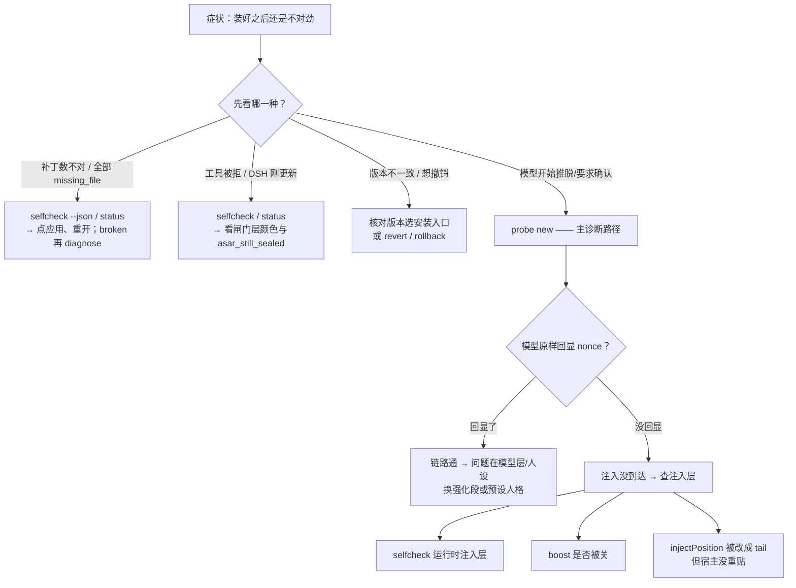

# 第 4 章 证据账本：自检、探针与口头说的不算数

> **开门一句话：**自检是点名册，探针是回声——点名册证明人都到了，回声证明隔山的那个真的听见了。

> "Facts are stubborn things."
> ——John Adams

## 学习目标

读完这章，你能做到：

- 说出 `selfcheck` 五个状态各代表什么，并把 broken → exit 1、pending 不是故障这两条讲清
- 画出"模型推脱 → 探针判读 → 模型层或注入层"的二分路径
- 复述证据分级四种标记、审计留痕范围，以及计数或哈希报错先查什么

**难度定位：**操作与判读章。前置：第 2 章的「应用/重开」节奏与第 3 章的注入层概念。4.1 读输出，4.2 一次回声实验，4.3 的表和图可贴墙；4.4、4.5 讲自律装置。

---

## 4.1 口头说的不算：25 层自检与五个状态

"我装好了，应该没问题。"——口头不算。插件给的是逐层证据。

`purge-community selfcheck [--json|--text]` 一次吐出 **25 层逐层证据**，每层单独判，不合成一个含糊的"健康"。退出码能进脚本：`broken → 1`，`pending/ok → 0`；人看 `--json` 里的 `layers[].state`。

五态是这套自检的词汇表：

| 状态 | 含义 | 颜色 | 该怎么读 |
| --- | --- | --- | --- |
| `ok` | 已确认 | 绿 | 这一层真的到位了 |
| `pending` | 待应用 | 中性 | **不是故障**，等一次「应用」 |
| `inferred` | 宿主推导 | 黄 | 没有直接证据，是从宿主状态推出来的 |
| `unknown` | 证据不足 | 黄 | 看不清，既不算过也不算坏 |
| `broken` | 已确认故障或权限不匹配 | — | 真坏了，退出码 1 |

黄有两种：`inferred` 靠宿主状态推导，`unknown` 是证据不足；都不算绿。

最容易被误伤的是 `pending`。说明书专门补了一句：

> **pending 不是故障——别去改补丁表，点一次「应用」即可。**

它是"还没打，不是打不上"。看见 pending 就去改补丁定义、动锚点，是把等待当损坏。真该动手的是 broken——让 `selfcheck` 返回 1，再 `diagnose` 看行号和旧锚点。

## 4.2 一枚 nonce 的回声

自检全绿也可能骗人：它只证明**宿主侧就绪**——文件被改、section 被注册。模型到底收到注入没有？这是另一件事。说明书把界线划得很清楚：

> 文件被改、section 被注册，只证明宿主侧就绪；探针证明模型**收到了**。

探针的做法很朴素，在 CLI 里生成一个随机口令：

```sh
purge-community probe new
# → {"nonce":"purge-1a2b3c4d", "message":"请原样输出下面这行…[purge-1a2b3c4d]"}
```

然后随便发一句对话，看模型会不会原样吐回这个 nonce。**原样回显 = 链路通。**nonce 存进 `probe.json`，**30 分钟自动过期**，不长期占 token：一次性实验，非常驻配置。

判读是严格的二分，不能含糊：

| 回显结果 | 结论 | 动作 |
| --- | --- | --- |
| 回显了，但模型仍推脱 | 链路通，问题在**模型层/人设** | 换强化段或预设人格，不要再拆宿主 |
| 没回显 | 注入没到达模型 | 往**注入层**查（见下） |

"没回显"这一支要按三个嫌疑点逐个看：

1. `selfcheck` 的**运行时注入层**——那一段是否真的绿；
2. `boost` 是否被关掉了——尾部强化段是注入的一部分，`purge-community boost` 可开关；
3. `injectPosition` 是否被改成 `tail` 却没让宿主重贴——`tuning.json` 存着 `{boost, injectPosition, askNoBlock, refusalRetry, extraPatches}`，位置改了宿主没重贴，注入就错位。

回显成功而模型依旧推脱，就不是插件的锅——继续拆宿主只会白拆。分水岭一句话：**回声证明链路，推脱证明人格。**先让模型原样念出 nonce，再争论到底是谁拦了你。

## 4.3 症状 → 动作：一张决策树

说明书的症状表，从现象直奔动作：

| 症状 | 先跑 | 判读 | 动作 |
| --- | --- | --- | --- |
| 补丁数不是 73/76（全量 84） | `selfcheck --json` | 看 `layers[].state` | pending → 点应用；broken → `diagnose` |
| 全部 `missing_file` | `status` | `ai_base` 为空 | 宿主未解包：点应用 → 重开 |
| 模型开始推脱/要求确认 | `probe new` | 回显否 | 回显：调人设/强化段；不回显：检查注入层 |
| 工具被拒绝执行 | `selfcheck` | 沙箱/审批层是否绿 | 绿 → 属工具自身限制；红 → 点应用 |
| DSH 刚更新过 | `status` | `asar_still_sealed` | 点应用 → 重开 → `selfcheck` |
| 面板显示版本不一致 | 面板顶部黄条 | 界面与后端不同版本 | 先核对磁盘与运行版本；按 README 选择正确安装/迁移入口 |
| 想撤销一切 | — | — | `revert`（只撤补丁）/ `rollback <id>`（回滚插件） |

表里两个补丁口径不矛盾：**86** 是全表（含 18/19 两条默认关闭的可选补丁），**84** 是生效口径（86 − 2）。判读一律看 `selfcheck --json` 的 `layers[].state`，别拿总数硬比。

以"模型推脱"为干——它同时牵着宿主层和模型层，是误判重灾区。整张树如下：



整棵树由一句口诀撑着：**不确定就点一次「应用」，重开，再自检。**但"模型推脱"这一支要先过探针——它决定你点应用还是换人格。

## 4.4 证据分级：claimed、inferred 与升级

自检和探针管"注入到没到"，账本管"谁说的、凭什么信"。从 1.6.81 起内置，给不同来源的证据打不同标记。

- **口头报告记 `claimed`，并填 `source_agent`。**某个 agent 说"我核实过了"只是声称；账本要求留下是谁声称的。
- **工具默认按 `inferred` 记录。**工具跑出来的结果也不是铁证，而是"推断级"——除非再核实。
- **`redteam_evidence_upgrade` 提交实际核实结果。**把证据从 claimed/inferred 抬上去走这个专门工具。普通引用、旧版缺核实记录的引用，账本**保留不删**，但标注"需另行核实"——历史不清零，只是不冒充已核实。
- **已撤回的问题可按 `withdrawn` 查询。**问题可以撤，但撤回本身留痕、可检索，不留一串删干净的空洞。

导入也有规矩：**文件须位于当前靶标目录**，可暂存其 `incoming/` 子目录，也可直接传截图内容。不进靶标目录就不算这个靶子的——这是归属问题，不是格式问题。

止损阀：**计数或哈希报错时，先处理账本异常。**数字对不上、摘要校验失败，先查账本本身——账本脏了，上面所有判读都不可信。这本书里就有现成例子：README 说 86 条，症状表写全量 84，两个都对——口径不同而已（见 4.3 表下的注）。凡是"数出来的结论"，都要回落到能指明口径的证据，而不是转述某个数字。

## 4.5 审计与轮转：可追责的每一步

账本之外还有一本流水：`$DSH_HOME/dsh-purge-community/audit.jsonl`，记录**最近动作**——`apply`、`revert`、`boost`、`probe`、`preset`、`reanchor`、`refusal_retry` 都留痕。两个入口：CLI 的 `purge-community audit [--limit n]`，面板的**「维护 → 最近动作」**。

容量纪律：**1MB 轮转，保留 2 份。**滚到上限就切，只留最近两份——够回溯，又不吃磁盘。

还有一组状态文件，可安全读、别乱写——它们是证据，不是草稿纸：

| 文件 | 内容 |
| --- | --- |
| `probe.json` | 探针 nonce（30 分钟 TTL） |
| `tuning.json` | `{boost, injectPosition, askNoBlock, refusalRetry, extraPatches}` |
| `anchor-overrides.json` | 本地重锚覆盖，删掉即恢复出厂锚点 |
| `applied.json` · `installed-rev` | 上次应用的插件版本 |
| `backups/<id>/` | 快照（`manifest.json` + 小文件，大文件在 `objects/`） |

其中一个开关值得单独说：**拒绝检测 + 单次重试**（1.6.34 起）。回答被中断时，`purge-community retry on|off`（默认 off，存 `tuning.json` 的 `refusalRetry`）只重试一次，避免死循环；每次重试写 `audit.jsonl` 的 `refusal_retry`，只记长度与前 80 字符。排查拒绝率先看 `audit --limit 20` 有没有 `refusal_retry`，再决定是否调整 `tuning.injectPosition`。还要分清：`refusal_retry_outcome` 的 text / tool_call / reasoning_only / empty 只表示传输形态，error / cancelled 表示失败或取消——都不能当成任务成功的证据。

这些文件撑起一条不变量：**`prompt-inject.md`、规则集、其他插件配置，任何时候都不该被「应用」或「回滚」覆盖。**注入正文只读（除非你亲手点保存）。审计流水加上这条不变量，才是"拆别人的闸、给自己修更讲道理的闸"：每一步留痕，且有权界。

**动手：**跑 `purge-community selfcheck --json`，把 25 层里非 `ok` 的层挑出来，对照 4.1 的五态表各写一句判读；再跑 `purge-community probe new`，把生成的 nonce 发给模型，记录它是否原样回显、30 分钟后是否过期。

---

账本还有一位最重要的用户——红队。下一章看它如何把打哪里、谁授权、证据在哪，写进合同。
