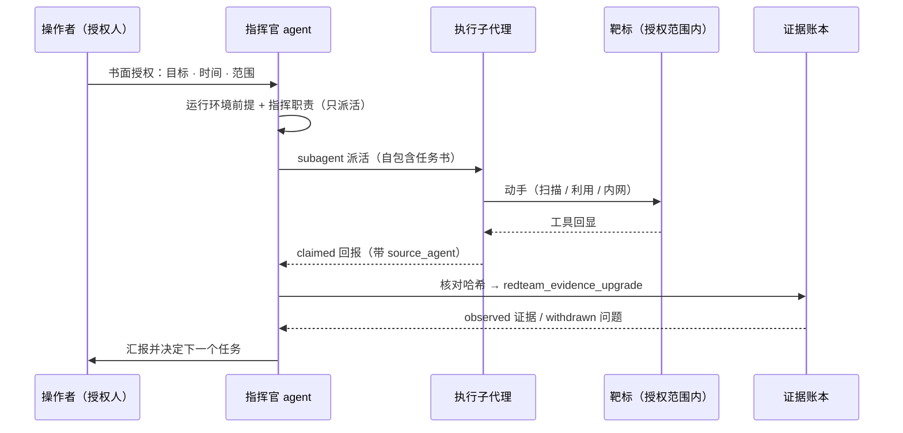

# 第 5 章 红队指挥官：只派活，不下场

> **开门一句话：**指挥官握的是派活单，不是扳机——他自己不下场，是因为有人替他下场，而且每一步都有账可查。

> "The general who wins a battle makes many calculations in his temple ere the battle is fought."
> ——Sun Tzu, The Art of War

## 学习目标

读完这章，你能做到：

- 说出红队预设怎样把执行 agent 变成调度官，以及指挥稿里两段标题的原文
- 画出指挥官→子代理→靶标→证据账本的消息流与四个置信度档位
- 复述 CTF 合同剥离、网段授权说明剥离、证据分级三处取舍的理由

**难度定位：**工程叙事章。前置：第 4 章的证据分级。5.1 从一个真实回归事故讲起，没有渗透背景也能读；5.4 的账本表值得抄下来。

---

## 5.1 为什么红队需要指挥稿

先看一次事故。`upstream/release-notes.md` 记着一条修复：红队指挥的"只派活"约束在组装时被误删，模型于是自己动手、不再派 subagent——"比原版红队差、也像'新版本不会派子代理'"。以派活为核心的模式丢了派活约束，就只剩一个裸跑的执行者。

问题出在身份清洗。旧版本把整段"你是谁、你不做什么"删掉，而"只派活 / 自己不动手"正写在其中，于是一起被砍。`lib/identity.js` 的注释把教训钉在原地：

> 以前整段删掉「你是谁、你不做什么」，会把「只派活 / 自己不动手」指挥硬约束一起删掉，模型就自己动手、不再派 subagent。身份冲突已由 inject 置顶处理；这里只保留操作稿，不再砍指挥职责。

修法克制：`withoutRedteamLeadIdentity` 现在什么都不改，只去空白；保留的是 `redteamOpsBody` 从 `REDTEAM_OPS_MARK`（值 `## 运行环境前提`）切出的操作稿。旧标题 `## 你是谁、你不做什么` 被 `redteamProcedure` 改写成 `REDTEAM_LEAD_DUTY`（值 `## 指挥职责`）并加"硬约束"，免得再被当成身份句误删。

于是指挥稿定型成两份契约。第一份是运行环境前提：红队会真实发包、上传、建隧道，优先在专供演练的虚拟机里跑，别拿日常办公机当主战场——私钥落盘、马与扫描器被 EDR 拦查、出口 IP 信誉受损，风险都在。第二份是 `## 指挥职责`，原文写死四件事：

> ① 计划智能体任务 ② 派活 ③ 分析子智能体回报 ④ 向用户汇报并决定下一个任务。你自己**不动手**：不扫描、不爆破、不利用、不上传、不登录、不探测内网。动手的活一律派给执行角色。

不是靠模型自觉。`lib/capability-protocol.js` 的 `REDTEAM_LEAD_PROTOCOL` 用英文再钉一遍："You plan, dispatch with `subagent`, verify results, and report. Executors do hands-on work." 指挥官能直接调用的只有读操作（`redteam_*` 查询、`redteam_sessions`、`redteam_attack_chain`）与派活前后的 `redteam_preflight` / `redteam_agent_slot` / `redteam_session_info`。派活必须用原生 `subagent`，不许换成 `spawn_teammate`：角色稿、并发闸门、叶子约束都挂在 `subagent` 这条路上。

## 5.2 CTF 合同：两段合同不能互相掐架

红队与官方共用一份注入正文，但正文里藏着一段只属于官方模式的竞赛沙箱约定，结构标记是 `CTF_INJECT_MARK`，值 `CTF CORE CONTRACT`。源码注释写清了为什么要切开：

> 这一句及其后文是竞赛沙箱约定，只留给官方模式。红队带上它会和运行环境前提抢授权判断。

抢的是同一个位置：`## 运行环境前提` 和 `CTF CORE CONTRACT` 都在回答"这一仗允许怎么打"。两份授权判断同时塞进模型眼前，它就自己决定听谁的——这正是要避免的二义性。一段正文里，只允许一套授权判断。取舍由 `splitRedteamInject` 完成：它从 CTF 标题处切成 `common` 与 `ctfTail`，`withoutCtfContract` 取前者，`modePromptText` 在红队模式走这条分支，官方模式原样保留。

切割很细。`isContractHeading` 只把**独立成行**的标题当结构标记：代码块里的同名行不算，正文里偶然出现的同名词也不算；大小写变体必须在随后 4000 字节里确有 `scope and evidence` 或"竞赛沙箱"才认。`lib/test/review-integrity.test.mjs` 钉了这些边界——引用、反引号、代码块里的词都不触发切割。

| 正文段 | 官方模式 | 红队模式 | 由谁决定 |
| --- | --- | --- | --- |
| 通用注入正文 `common` | 保留 | 保留 | 两种模式共用 |
| `CTF CORE CONTRACT` 及后文 `ctfTail` | 保留 | 剥离 | `splitRedteamInject` 切点 |
| `## 运行环境前提` / `## 指挥职责` | 不涉及 | 保留为操作稿 | `redteamOpsBody` / `redteamProcedure` |

合同与指挥稿各管一段，切开是为了互不干扰——红队只看指挥稿，官方只看竞赛合同。

## 5.3 两份副本：给人看的，不进模型眼前

第二处剥离更隐蔽。`lib/identity.js` 的 `stripRegionLecture` 用 `REGION_LECTURE` 正则匹配网段禁区说明，从注入给模型的正文里换掉。注释信息量很足：

> 禁区说明留在提示词文件里给用户看。注入给模型的那份拿掉，避免它自己去核对网段。

这就是"两份副本"设计。同一份提示词文件，人打开能读到完整的网段授权说明与法律边界；模型那份副本里，这段被剥掉。为什么分开？模型看到"禁止打哪些网段"后，会拿清单去**自行核对**目标——授权是人的责任，不该下放给执行链里的一环。把授权文本塞进模型视线，就是把判断权交了出去。

`modePromptText` 把两次剥离串在一条道上：红队先 `withoutCtfContract`，再无论哪种模式都过一遍 `stripRegionLecture`。模型眼前的副本永远最小，档案里那份完整文本一字未动。

## 5.4 证据账本：口头的不算数

红队把"证据"做成硬结构。`lib/redteam/evidence-ledger.mjs` 定义四档置信度，语义是红队化的：

| 档位 | 含义 | 指挥智能体怎么处理 |
| --- | --- | --- |
| `claimed` | 子智能体口头报告的"我拿到了" | 绝不直接采信，必须核对 |
| `observed` | 工具回显 / 数据库记录证实的 | 亲自核实后采信 |
| `derived` | 从 `observed` 推理出来的 | 保留推理链 |
| `inferred` | 子智能体或指挥智能体的推测 | 必须标注 |

规矩写在代码里。`record()` 的 `confidence` 默认 `inferred`；`claimed` 或 `subagent-report` 必须填 `source_agent`，否则拒收。`ev_id` 是规范化语义的 SHA-256，改一字哈希就变——落库后能反验"子智能体说 A，库里记的是不是 A"。核对工具只报 `matched`，且明说 claimed / inferred 仍须独立核实。子代理说"拿到了"，只是线索；没进账本、没升到 observed，就不算证据。

升级走单独工具 `redteam_evidence_upgrade`：把 `claimed` / `inferred` 升到 `observed`，必须带 `verified_result`（亲自验证的回显或数据）。与 AGENTS.md §9 口径一致：口头报告用 `claimed` 并填 `source_agent`，工具默认 `inferred`，用 `redteam_evidence_upgrade` 提交核实结果。导入文件须位于当前靶标目录，可暂存于其 `incoming/` 子目录；已撤回的问题按 `withdrawn` 查询——它是 `residual_unknown` 的合法状态之一。

门槛写在同一节：Node ≥18 够桌面版用，**红队工具需 ≥22.5**，因为它依赖 `node:sqlite`，低版本会在加载红队工具时失败。这不是建议，是加载期就会撞上的硬失败。

## 5.5 红队不是放开打

把三件事合起来看，红队的自律就成形了。它靠的不是一句"大胆去打"，而是三件套：

- **合同**回答"打哪里"：`CTF CORE CONTRACT` 只在官方模式留着，红队只看指挥稿，两套授权判断不打架。
- **授权**回答"谁批准"：`docs/drill-auth-legal.html` 是进入演练台前必须全文阅读的法律与合规声明，写明允许范围——本人有权管理的本机 Harness、离线本地合成靶标、有合法书面授权的演练靶场、合规实验室受控环境；本机操作不构成对外授权，书面授权要对应具体目标、时间和范围。演练台存在，但边界写在声明里。
- **账本**回答"证据在哪"：四档置信度、语义哈希、`redteam_evidence_upgrade`、`withdrawn`，让"拿到了"必须变成可核对的记录。

拆掉别人的闸，不等于自己不设闸。红队把执行权下派给子代理，却把授权判断留在人手里、把证据判断钉进账本。指挥官不下场，正是为了让三件事各自负责、彼此不被越过。

**动手：**通读 `docs/drill-auth-legal.html`（只读，不进演练台），列出它要求你逐项确认的授权条件；再对照 5.4 的四档置信度，检查你自己最近一次实验记录里，哪些结论还停在 `claimed` 而没升到 `observed`。

---

拆闸的技艺到这里讲完了，下一章讲拆闸者的修养——把这套经验搬回你自己的工程。
