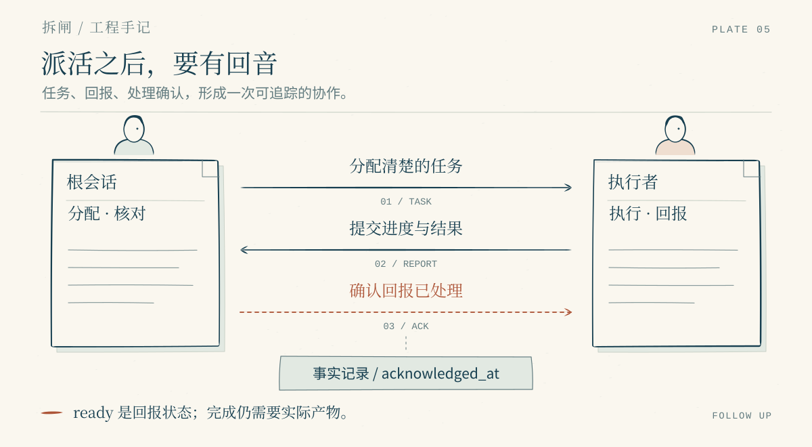
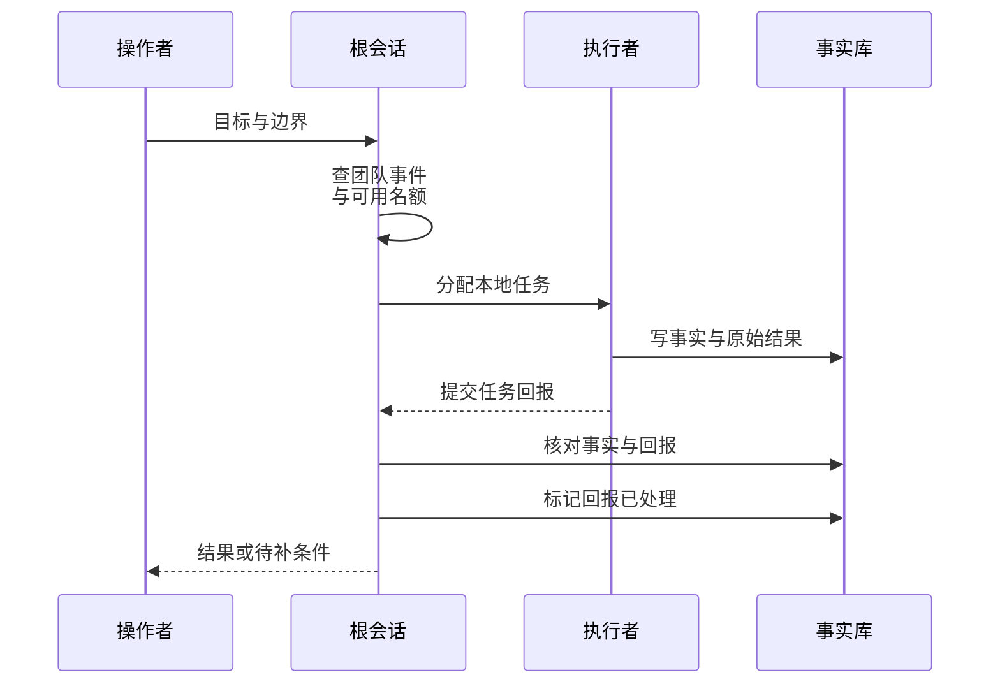
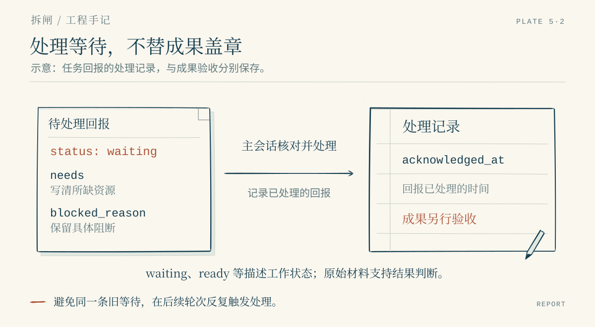

# 第 5 章 红队指挥官：任务、角色与官方 Teams

多个代理同时工作时，主会话需要知道谁在执行、谁在等资源、哪份回报已经处理。本章从根会话和执行者的角色稿读起，接着检查 team/mode 事件、名额统计与回报确认，再核对 Super Agent 发布说明和设计方案中哪些已有实现。

这里接续第 3 章的模式分支和第 4 章的任务回报。练习只使用本地虚构记录，不需要执行网络演练。



## 5.1 身份清洗不能一起删掉职责

角色提示词里常把“你是谁”和“你做什么”写在一起。处理官方身份时，如果整段删掉，就可能把“自己只负责调度”也一并删掉。当前 `identity.js` 保留操作稿，从 `## 运行环境前提` 找起点，并兼容把旧标题改为 `## 指挥职责`。

身份文本可以折入统一 persona，岗位职责仍要留给承担该岗位的会话。当前实现按三种情况处理：

| 会话类型 | 模式稿处理 |
| --- | --- |
| 普通会话 | 移除红队操作稿、目标卡与角色稿，保留通用正文 |
| 红队根会话 | 保留指挥操作稿，按输入附加目标卡与角色稿 |
| 红队执行子代理 | 移除指挥操作稿，只插入适合执行的角色稿，并去掉 team:policy |

根会话可以把工作拆开、分配、检查回报，执行者则拿清楚的任务和边界继续做。子代理不因为继承父会话的正文就自动继承指挥岗位。

源码注释记录过一个执行子会话读到大段团队调度文本、一直协调却不干活的例子。具体调用次数是那次上游现场的描述，本书没有重跑；可以核对的是现在的分支确实删除了执行者不该收到的团队说明。

## 5.2 官方 Teams 开关落在会话里

DSH 新版的团队工具受会话级 `team/mode` 事件影响。只在预设文件里写“启用团队”，并不能保证第一轮工具目录中真的出现团队工具。`team-mode.js` 为此把事件写到红队根会话。

它遵守几条具体条件：先检查日志里是否已有 team/mode；已有记录就尊重，包括 `enabled:false`。接着识别红队和根会话，只有符合条件才补写一次。普通会话和执行子会话不由它打开团队模式。

“根”也有陷阱。历史续接或分支可能带 `parentSession`，但仍是新的根会话。当前判断看 `origin` 和 `delegationDepth`，不会只因有父指针就当作子代理。这件事同时影响状态继承、角色稿和工具可见性。

另一个边界是中途切预设。用户从 standard 切成 redteam 时，宿主不一定再发 agent/created。模块还监听 `agent-preset/selected`，并用 pre-step 兜底；暂时“不是红队”的会话也不永久记入已处理集合。否则第一次判错就永远错过后面的切换。

这套逻辑可以用一个极小的假会话实验复核：只提供 header、events 和 append，观察第一次返回 enabled，第二次 skip-already；再造一份用户已关闭的日志，确认不被重新打开。它验证事件逻辑，真实工具目录仍要到宿主中查。

## 5.3 名额不是一句“最多三个”

`redteam_agent_slot` 有 status、acquire、release 三个动作。它结合真实子会话注册表与尚未变成子会话的预留：

```text
used = max(live.running, reservations.length)
free = max(cap - used, 0)
```

默认上限是 3，设置和环境变量可以改变它。取较大值的目的是减少“预留已经变成运行会话”时的重复计数。这是一种防漏计/重复计数的近似处理，不能据此声称它已成为持久化调度引擎。

acquire 满额时会拒绝；它建立的名额是调用这条工具路径的约束。不能扩大为“整个宿主任何 spawn 都受同一强制上限”，其他入口是否统一经过这条检查，需要另查。

派活失败时释放对应预留；子会话正常结束有自动释放路径。等待资源的执行者可以报告 waiting 或 blocked 并让出名额，避免一个不运行的任务长期占位。诊断时要同时读实际运行数、预留数、parked 和注册表是否可用。

## 5.4 回报被处理过，才算收口

任务回报表提供了 `needs` 与 `blocked_reason`，主会话可以回答“谁还在等什么”。但没有 `acknowledged_at`，旧等待记录会一直参与下一轮判断，形成不断重复的催办。



本地练习可以是整理一批虚构资产的标签。执行者报告“已整理 12 条”，主会话就去读这 12 条是否存在、字段是否齐全；有错误就写具体差异。这个练习可以检查派活、回报与复核是否接得上，无须进行网络演练。



角色稿、名额和状态表各自解决一个问题。它们合在一起，让自然语言调度有了可查询的支撑，但每条“完成”仍应连回实际产物。

## 5.5 Super Agent：发布名词之后逐项查

发布说明明确写了新增 Super Agent 支持。参考树中的 `docs/redteam-superagent-design.md` 开头也明确写着“设计与差异分析，不含实现”，并引用了较早版本。配套 dev 文档列出未来 SQL 和工具方案。不能把这些代码块直接登记为已发布能力。

核对当前树后，可以得到更具体的表：

| 项目 | 当前证据 | 本书结论 |
| --- | --- | --- |
| 结构化任务回报 | schema 的 agent_report 与存储处理 | 已有实现 |
| 官方团队任务板接入 | team-mode.js 写会话事件 | 已有实现；实际工具可见性需宿主验证 |
| 派活名额 | redteam_agent_slot 检查注册表与预留 | 已有实现，范围限相应调用链 |
| 执行角色注入 | role-section.js 与 identity.js 的子会话分支 | 已有实现 |
| dev 文档提出的 agent_task 表 | 当前 schema 未见该表 | 保留为设计方案 |
| 提案中的 redteam_agent_task 工具 | 当前工具注册未见该名称 | 不写成命令速查中的现成工具 |
| 原型的持久 Ticket/Assignment/Effects 引擎 | 设计稿用来比较的对象 | 不推定当前插件已完整移植 |

早期文档写“名额只是建议”时，当前代码已经发展出注册表核对。这个例子提醒读者：设计稿既可能写了尚未实现的未来，也可能保留已经过时的现状。按条目追到函数和 schema，才能分清。

## 5.6 演练台确认与具体授权

进入 Drill 的确认记录保存在当前 `$DSH_HOME/dsh-purge-safe/drill-grant.json`，字段包含 granted 和时间；Web 与桌面各记各的。插件更新不会仅因换包就删除这份记录，成功卸载会清理。

这个文件记录的是用户接受进入演练台的确认，里面没有逐个目标、有效时间和书面授权附件。具体演练范围仍需要操作者明确记录。提示词约定、确认记录和工具代码中的校验，需要分别判断其作用。

::: {.case-note #case-report}
**案例 · 回报 ready 后仍要打开文件**

教学回报可以依次写为 progress（开始处理）、waiting（缺少最后一条输入）、ready（已交回结果）。主会话收到 ready 后运行内容校验；若仍缺 A12，就记录差异并要求补齐。旧 waiting 已处理的时间可记入 acknowledged_at，但这个时间不替代最终文件的验收结论。
:::

**动手：**用虚构任务填一份 progress、waiting 和 ready 回报，给 waiting 写 needs，再说明什么时候可以标记 acknowledged_at。最后在设计稿中挑一个工具名，回源码确认它有没有注册。

---

下一章把这些核对动作整理成工程方法：版本、路径、备份、重启和文档，各自要承担什么证据责任。
