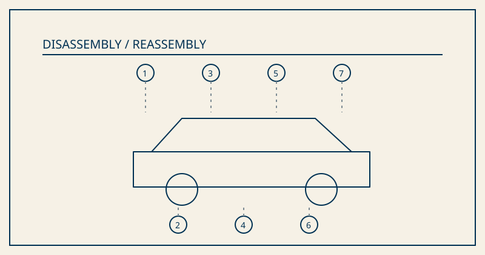
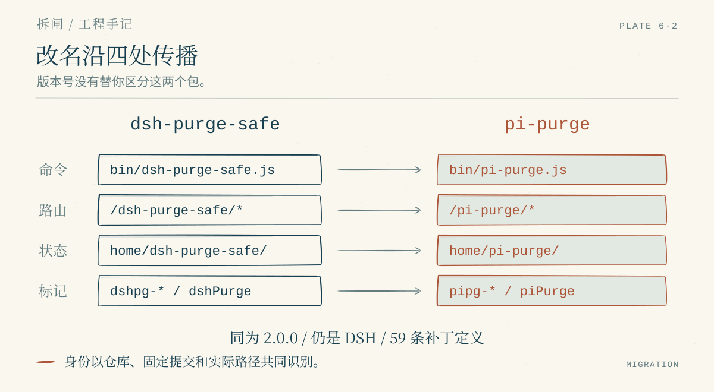
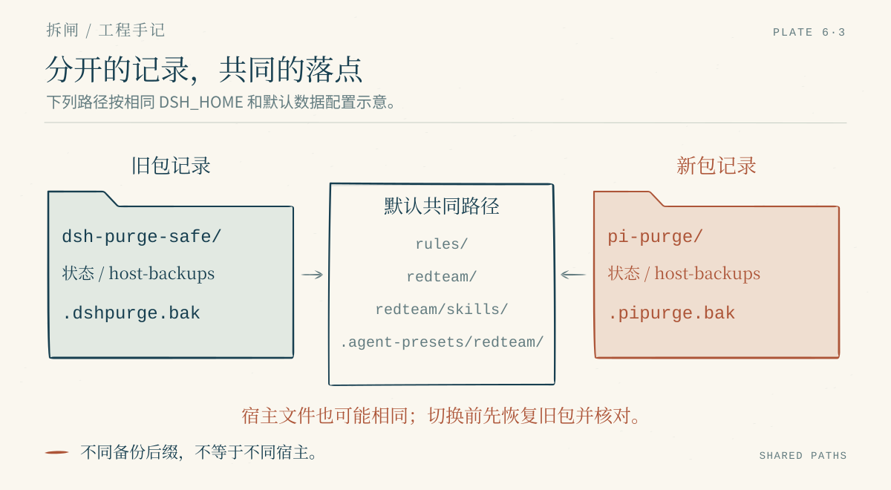

# 第 6 章 造车记：把拆闸的经验还给工程

宿主升级之后，原来的路径、备份和验收结果还适用吗？维护时要能回答这些问题，就得给安装与恢复留下阶段记录。本章接着前五章的状态和组装概念，整理文档核对方法，并把超时、重试、确认和任务成功分别记录。

第 6.2 节的七项验收表可以直接用于自己的自动化项目。第 6.7–6.8 节再用两个固定仓库说明改名迁移与测试边界。

## 6.1 恢复不是把 bak 拷回去就结束

第 2 章已经看到，旧备份可能和新宿主不再匹配，符号链接也不能当普通文本入口。恢复动作需要知道原文属于哪一版、目标是什么文件类型、当前文件是否仍受插件控制。

写入前保存备份时，也应留下路径、文件摘要、宿主版本与插件提交。否则下一次更新之后，即使备份还在，也可能无法判断该还原哪份。

源码里还有一个实际取舍。`atomicWriteFile` 优先写临时文件后 rename，但遇到可重试的占用错误，会退到直接写目标再重试。因此不能把函数名解释成所有平台、所有分支都绝不出现中间状态。对重要配置仍要在写后读取与解析，失败时留住可恢复原文。

幂等、原子性、备份与成功报告解决的是不同问题。把它们全叫成“安全写入”，会让验收失去落点。

## 6.2 一次安装验收的七项记录

Web 与官方桌面应各留一份安装记录。下面七项按实际动作排列，后续更新可以沿同一顺序复查。

| 记录 | 要核对什么 | 常见误判 |
| --- | --- | --- |
| 版本身份 | 本地包的 version、目标宿主与固定提交 | 同名仓库等于同一版本 |
| 入口归属 | surface、process_surface、profile、home | Web 成功就表示桌面也成功 |
| 文件落点 | ai_base、目标文件与是否仍密封 | 找到一个 @deepseek-ai 就是当前目标 |
| 写盘结果 | complete、host_written、failed_items | HTTP ok 或退出码 0 等于全成功 |
| 新进程加载 | 重启后的入口、版本和逐项状态 | 磁盘已经有标记就代表运行中生效 |
| 本地任务 | 固定输入、原始输出与产物 | 模型说“完成”就验收 |
| 恢复路径 | 正确版本备份、文件类型、失败保留 | 删除插件等于恢复宿主 |

Windows 里还要核对进程是否真的结束。启动 GUI 程序的命令返回，并不总表示对应进程退出；需要等待明确的进程对象并读取其 ExitCode。

读取中文 JSON 和日志时，PowerShell 5.1 显式使用 `Get-Content -Raw -Encoding UTF8`，可减少乱码误判。路径包含中文或空格时也要验证工具实际收到的参数；“命令看上去正确”不足以证明参数没有被拆开。

## 6.3 让文档接受同样的检查

来源文档与实现发生冲突时，应把结论连到具体函数，并记录差异。附录 A.6 集中列出本次核对的差异，SOURCES.md 保留定位依据。本书的基线检查由本书仓库提供。

`build/baseline.json` 记录仓库、提交、版本、补丁集合与关键文件 SHA-256。`check_reference.py` 复核这一份源码，并跑无副作用的组件实验。摘要变化要求重新核对，不能只因为 package.json 仍写 2.0.0 就继续沿用结论。

文档也有不同证明力。package.json 声明目标版本，不代表每台机器都验收通过；设计文档列出 SQL，不代表数据库已经创建；发布说明声称稳定性改善，不代表有量化对照实验。把这些差别写在来源表里，读者就知道下一步去哪里找证据。

## 6.4 等待时间、执行时间与重试

长任务看上去“卡住”，可能只是前台等待策略不同。实际等待行为需要回到当前宿主的服务与配置核对。

一般地，缩短前台等待并不会让命令本身算得更快。宿主若支持超时转后台，调用会更早拿到任务 id，命令继续运行；若没有这项服务，超时可能终止执行。先核对服务和配置，才知道等待参数是什么意思。

自动重试又是另一件事。当前默认最多重试 3 次，自动续跑默认关闭；鉴权、配额和上下文长度等错误不能靠同样的请求重复解决。用户取消应当停止。重试日志应该解释为什么重试、重试了什么以及最终留下什么，不能只给一个“已恢复”的标签。

把这几类时间分开记录，性能讨论才有意义：调用等待了多久，任务运行了多久，重试增加了多少总时间，实际结果有没有变化。本书没有对这套插件做速度基准测试。

## 6.5 用户数据的生命周期

插件目录、home 中的状态文件和项目工作区有不同生命周期。升级主要替换源码，确认记录和事实库可能仍在 home；卸载会执行更广的清理。用户稿与默认稿也有不同保护逻辑，第 2.6 节已说明。

这影响备份设计：只打包插件目录，未必带走演练事实；只保存 home，未必知道当时跑的是哪份源码。迁移记录应同时保存版本身份与数据位置，恢复后再检查关联是否仍正确。

README 对授权范围和用途有说明，演练台另有确认页面。书中的工程示例只涉及本地测试与虚构记录。记录 granted 的文件不替代具体项目的目标范围，提示词里的“允许”也不替代系统所有者的授权。

来源署名同样按材料分清：本书是独立书稿，沿用自身许可证；参考插件的代码、提示词、NOTICE 和 LICENSE 仍属于其相应权利文件。这里记录来源，不对它们的条款冲突作额外法律判断。

## 6.6 可以搬回项目的七条

改名案例还能补上一项检查：外观相似的两个包，可能同时改动相同文件，却各自保存备份、识别标记。第 6.7–6.8 节用固定提交说明这一点；下面的表格仍是一般维护清单。

| 经验 | 当前工程的例子 | 搬回项目时的检查 |
| --- | --- | --- |
| 按集合计数 | 四段数组合计 59，id 最大 96 | 序号与记录数分开 |
| 展示与执行分开 | 三组展示折叠，全表仍遍历 | UI 合并后执行有没有少项 |
| 包装方法防重入 | 全局 Symbol 与共享 slot | 安装两次是否重复包裹 |
| 同时核对静态和动态输入 | sections 与 contexts 分别处理 | 下一轮刷新会不会带回旧内容 |
| 恢复识别版本和类型 | 陈旧备份刷新、符号链接特殊处理 | 会不会拿旧原文覆盖新入口 |
| 工作流状态有收口 | agent_report 的 acknowledged_at | 已处理的等待是否还在重复触发 |
| 文档结论需要实现入口 | 固定提交、文件摘要、离线实验 | 声称存在的函数和工具是否可找到 |

把这些问题写进审查单，再按自己项目的调用链确定具体检查。参考工程中的常量不一定适用于另一套实现。

::: {.case-note #case-handoff}
**案例 · 交付时留下两种不同的结论**

案例目录保留输入、缺项输出、完整输出和 verification.json。记录含三个文件的摘要、失败原因与逐条比较结果。

交接写明“本地转换与内容校验通过；真实宿主未测”。接手者先重跑校验，再补自己的宿主记录。
:::

**动手：**选自己的一个脚本，按第 6.2 节补齐七项记录，分清已测与未测。

## 6.7 从 dsh-purge-safe 到 pi-purge

2026 年 11 月 20 日核对时，zhuguang-ZFG/dsh-purge-safe 的提交为 `cc881fbd68b891772330c6b0d275b0c971794e00`，与本书主基线一致。pi-purge 固定在 `5cd5f3551fba1c7320751b825e9167da5af6c25e`，仍声明 DSH 0.2.2-rc.3，包版本也仍是 2.0.0。两个包都显示 2.0.0，不能据此认为它们可以互换。附录 A.8 列出安装身份；这里看运行时留下了什么。

这次改名贯穿命令文件、HTTP 路由、home 状态目录、备份后缀、提示段名前缀和防重入标记。把已跟踪文件中的六组名称映射后比较：92 个文件原样相同，52 个只剩映射差异，9 个另有变化；新仓库增加 MIGRATION.md。core.js 和 identity.js 属于名称映射即可对齐的文件，事实库 schema 与 store-core 则逐字节相同。这是两个固定提交间的比较，不能外推以后版本。

路径变化不能直接推出“互不干扰”。`$DSH_HOME/pi-purge/` 与旧状态目录不同，但规则仍落在 `$DSH_HOME/rules/`，事实库默认仍在 `$DSH_HOME/redteam/`，预设仍使用 `.agent-presets/redteam/`；随包技能同步到 `redteam/skills/`。显式 root 或 REDTEAM_HOME 可以改变事实库位置，应记录实际配置。预设自举还会检查进程 home 与默认 `~/.dsh`，只看一个环境变量不一定看全写入落点。

两个包也会面向同一个宿主文件。MIGRATION.md 明确要求切换前先恢复旧包，不要同时 Apply：它们各自识别自己的补丁标记，回滚不能被解释成替另一套改动清场。备份后缀不同只说明记录分开，不能证明当前宿主原文未被另一套修改。

迁移前应保存旧提交、入口、实际 home、宿主路径和共享数据的副本；按旧包恢复流程核对逐项结果、原文摘要及剩余标记。旧包停止加载后，再配置新包，复核共享预设指向的新工具包和独立状态是否需要重新设置。没有核对前，不把旧目录改名当成迁移完成，也不把旧备份当成新包的官方原文。此处给出核对顺序，未宣称已经完成真实宿主迁移。

## 6.8 临时目录为什么没有隔离真实宿主

MIGRATION.md 第六节记载，验证 `applyPatchesAllHosts()` 时误命中了作者机器上的真实 DSH。作者称回滚 47 个文件，以 SHA-256 确认 55/55 一致，再清理备份与记录。本书未重现事故，也未独立核实恢复状态。

文档简述为“不读 DSH_BASE”。实际 `enumeratePatchAiBases()` 会读它，但此前已经加入当前进程、home 和其他发现的安装；`applyPatchesAllHosts()` 收到 `options.aiBase` 后也仍追加枚举结果。两者都是候选路径，不能限制扫描范围。临时目录接住部分数据，不会阻止探测真实安装。

本书实验只调用纯函数和假对象，不调用 Apply、revert 或插件启动入口。Node 权限允许读取、拒绝写盘与子进程，并通过写入和启动被拒绝的断言确认限制生效；报告由父 Python 进程写入。这用于防止本实验意外写盘，不是执行任意不可信插件的完整沙箱。

安装、写盘和恢复实验应放在没有真实安装、可丢弃的独立环境中，由执行层限制允许的目标，并记录目标清单、初始摘要、写入报告与恢复后摘要。本书的两仓源码、异常分支和双重包装检查不执行这些写盘实验。
