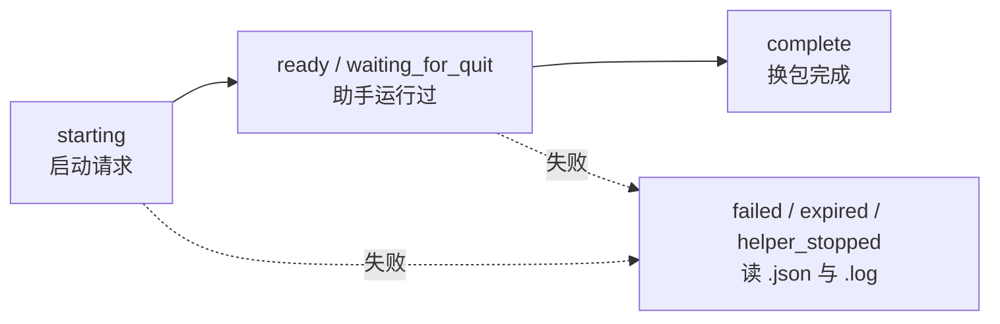

# 第 6 章 造车记：把拆闸的经验还给工程

> **开门一句话：**把焊死的车门一颗颗卸下来之后，真正的活才开始——给每颗螺丝编号、拍照、写回装手册；拆是设计，记账才是工程。

> "Experience is the name everyone gives to their mistakes."
> ——Oscar Wilde

## 学习目标

读完这章，你能做到：

- 能说出拆掉宿主闸门之后，真正存活下来的五件纪律是什么
- 能画出一次 Windows 安装验收的证据链：从真实进程对象、真实 ExitCode 到 `asar_handoff` 相位
- 能复述两条底线：失败不能说成安装成功，组件模拟不能冒充实际 CLI 事务

**难度定位：**全书收束章。前置：第 1–5 章的全部机制。6.1 是观念，6.2 最硬（验收坑），6.3–6.4 是纪律，6.5 表可贴墙。

---

## 6.1 拆闸教会我们什么

宿主立闸是设计决策，拆闸只是把它摊上解剖台（第 1 章）。闸拆光了，靠什么补位？

拆闸者写下的设计原则只有四行：本机优先（不上传提示词或配置）、可见（动作都有证据）、可回滚（操作前快照）、不替你做决定（只减少摩擦）。这是拆闸者给自己立的规矩。

一个拆锁的工程，给自己修了一整套更讲道理的锁——

- **幂等**：每条补丁带 `[dsh-purge]` 标记写进 `markers`，重复「应用」不会打成两遍；不确定就再点一次。
- **备份与回滚**：归档备份独立命名，回滚走 `.tgz`，失败保留现场，不删备份来伪造恢复成功。
- **自检**：`selfcheck` 逐层给证据，五种状态把"已确认"和"证据不足"分开。
- **证据分级**：口头报 `claimed`，工具默认 `inferred`，核实过才升级；"拿到了"要变成可核对的账。

闸拆掉了，这些纪律留了下来：不拦你，只保证每句话有据可查。存活下来的"闸"是这套自律装置。**拆闸没有把规矩拆没，是把规矩接过来，写成你能查的账。**

## 6.2 安装验收的侦探学

安装最容易"以为成了其实没成"。下面七条，每条都对应一个真实误判。

**其一，看进程对象，不看 `$LASTEXITCODE`。** Windows Desktop 的 exe 是 GUI 子系统。PowerShell 的 `& exe ...` 可能在子进程结束前就返回，紧跟它的 `$LASTEXITCODE` 什么都证明不了——退出码为零，只说明报告生成了。安装器必须等明确的进程对象、查真实 ExitCode、收 UTF-8 输出，之后才清理 bootstrap。回归要覆盖普通 Node 控制台和真正的 GUI 子系统进程——只拿 node.exe 模拟 Desktop 不够。

**其二，看相位，不看文件后缀。** `/dsh-purge/status` 的 `asar_handoff.phase` 有严格语义：`starting` 只是启动请求；`ready` / `waiting_for_quit` 才证明助手运行过；`complete` 才表示保留原归档并完成换包。失败要看 `.json` 与同名 `.log`；`.rename-pending` 不是成功。状态与日志只含换包诊断，不上传配置。

**其三，备份不覆盖。** 归档备份 `app.asar.purge-<token>.bak` 独立于 profile 快照，已存在就不覆盖；等待期间归档被官方更新替换则停止，要求重新对新宿主应用。

**其四，是编码，不是损坏。** PowerShell 5.1 读 UTF-8 JSON/文档要写 `Get-Content -Raw -Encoding UTF8`；默认 ANSI 解码把中文变乱码，再被误判成安装包损坏——排查时最冤的假故障。

**其五，junction 要绝对目标。** 解包后无法再次安装，常见原因是 app/runtime 链接坏了：Windows junction 必须指向同 resources 目录下 runtime 的绝对目标，不能传相对的 `..\runtime`。新安装器保留旧错误链接再修复；遇到真实目录或其他有效运行时冲突就停止，不删内容。

**其六，错误码要拆开看。** `ERR_PNPM_MINIMUM_RELEASE_AGE_VIOLATION` 不等于"发布太新"。只有同时明确报 `@dsh-ops/bash-win32-x64@<版本> ... version not present in registry manifest`，才比对公开镜像与 npm 官方元数据；安装器仅对这一公开包、明确的公开镜像执行一次 scoped registry 重试。元数据（name/version/time/integrity/tarball）不完整就停止，其余依赖保持原源。其余错误（发布时间真不足、integrity/trust、私有源、未知）保持失败、保留日志，不要设 `minimumReleaseAge=0` 或 `trustLockfile`。

**其七，别注入 legacy API。** 原生已有 `describe` / `replace` 的宿主不能注入 legacy `register`，否则特性探测型插件读错存储。未显式设置不等于未生效：有效但未固定是 `inferred`，看不到是 `unknown`，确认不匹配或补丁错误才 `broken`；JSON/text 仅 `broken` 时退出码为 1，仍要读 `state`。

## 6.3 文档即契约

文档是发版时要过的门。

`npm run check:docs` 校验 `AGENTS.md` / `README.md` / `release-notes.md` / `package.json` 的版本一致，在 CI 跑，不一致直接失败——版本号从靠自觉变成会自动落闸的门：**文档里的每个数字都是承诺，CI 负责让你兑现。**

面向 agent 的细节以 `AGENTS.md` 为准——与 `README.md` 冲突时先信本文件，再去改 README；两份 README 必须一致，维护文档不能停在 1.2.0/1.3.0。

两条纪律：

1. **不能把失败说成安装成功。** 安装、应用、加载是三个阶段，安装不自动应用或重启。命令退出 0 不等于成功，要在新进程检查依赖、入口与配置合成，失败时恢复依赖图。
2. **报告必须区分口径。** 组件模拟、实际 CLI 事务、缓存复用、未测的 UI/宿主功能分开记录，不能以一种通过代替另一种。磁盘已应用不代表进程已加载；安装器测试不代表模型行为或全部 GUI 验收。

## 6.4 伦理与合规的边界

这套栈拆的是**你自己机器上宿主**的闸，前提是你拥有这台机器或持有授权。README 限定在本机学习、个人项目、自动化实验与维护工作，涉及他人系统先取得许可；"本机优先"同样要求不上传提示词或配置。

红队能力自带合同与演练台（第 5 章）。`CTF CORE CONTRACT` 只在官方模式留着，红队只看指挥稿；进入演练台前须全文阅读 `docs/drill-auth-legal.html`，限定本人有权管理的本机 Harness、离线靶标与有书面授权的演练靶场。本机操作不构成对外授权，书面授权要对应具体目标、时间和范围。

公开 issue 只附脱敏错误，不上传配置、凭证、提示词或完整备份；更新 Token 只发 `api.github.com`，不进日志、不发镜像。隔离实测要设独立 `DSH_HOME` 与 `user-data-dir`，不碰默认目录、不自动应用补丁；协议或登录确认交给用户决定。

本 fork 没有"目标解析到公网就拒绝"的门禁：那段逻辑已删除并有测试防止重新引入。范围由操作者自己声明，插件不替用户判断目标归属。**能力越大，越要把"谁授权、打哪里、证据在哪"写在动手之前。**

## 6.5 造车清单：七条可迁移经验

把全书压成一张表：经验、做法、搬回项目时要问的那句话。

| 经验 | 这套栈里的做法 | 搬回你自己的项目 |
| --- | --- | --- |
| 幂等靠 markers 不靠自觉 | 补丁带 `[dsh-purge]` 标记写进 `markers`，重复「应用」不成两遍 | 写操作先留"我做过"的证据，再谈重试 |
| 改源码必钉锚点回归 | `test/patch-anchors.test.mjs` 钉真实源码片段；漂移用 `diagnose` / `reanchor` | 文本改写要有"原文还在不在"的测试 |
| 展示聚合、执行全量，死代码要删 | `PATCH_DISPLAY_GROUPS` 把升级链合成一行展示，Apply 仍按 `ALL_PATCHES` 全打；#85/#86 被 #90 取代后连死 id 删除 | UI 合并不能改变执行集合；被取代的逻辑要删干净 |
| monkey-patch 必带防重入桩 | `Symbol.for("dsh-purge.assembleGuard")` 配 `_dshPurgeWrapped`/slot，重复安装只更新 rewrite，不再包一层代理（否则栈溢出） | 包装方法前先问"我是不是已经装过" |
| 长文本去重分层做 | `injectMatchers` 先全文精确比，再放宽连续空白；V8 对 RegExp 源码长度有上限，loose 匹配限长 4096 | 别造一条吞下整篇文本的巨型正则 |
| 文档与 CLI 版本由 CI 钉死 | `check:docs` 校验四份文件版本一致，CI 里不一致直接失败 | 版本号只留一个真相源，让机器负责对齐 |
| 证据分级胜过口头汇报 | 口头报 `claimed`（带 `source_agent`）、工具默认 `inferred`、`redteam_evidence_upgrade` 才升级、`withdrawn` 表示撤回 | "拿到了"必须变成可核对的账 |

发动机是七道闸门的解剖学，底盘是五层拆闸栈，仪表盘是自检与证据账本。真正带走的，是修车时立下的规矩。

**动手：**挑一个你自己的自动化脚本，按 6.2 的七条逐项自查：除了退出码，你还能拿出哪几样证据证明它真的装成了？

---

下一章是最后一章——车与马的回响。
