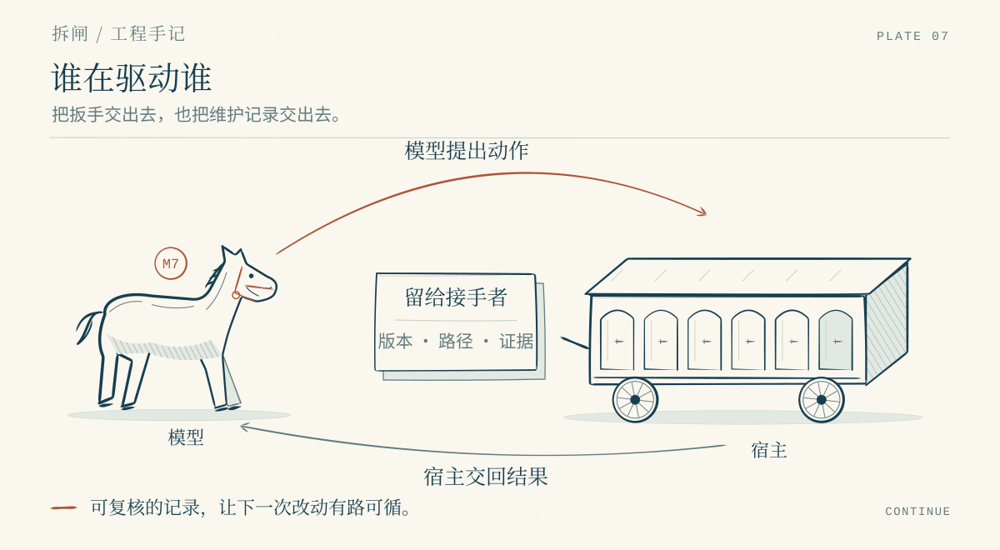

# 结语 车与马的回响

## 从那句“我不能”往回查

序章里的一次删除没有完成，可能停在模型提案、运行时放行、工具执行或结果回填。现在再看到那句“我不能”，手边已有几个可查入口：本轮有没有调用，进程使用哪份 home，文件状态是什么，最终输入怎样组装。

不能读文件，就核对真实路径；状态齐全却没有调用，就看本轮输入；模型报告成功，就打开产物再查一遍。沿这些入口追查，比只盯着回答措辞更容易找到故障位置。

safe 版没有把一切缩成“去掉约束”这一个动作。补丁集合、persona 折叠、动态 contexts、执行者角色稿、官方团队事件和事实库，各自处理不同的位置。读懂其中一个模块，不代表其他模块也自然正确。

## 数字随版本走

本书所读提交导出的集合是五十九条。最大编号到了 96，面板还能把若干条合在一行。数字没有失去价值；它需要附上所数的集合与版本。

证据记录也要带版本。演练台的 SQLite 结构保存原始报文、任务回报与结构化证明；字段或工具入口变化后，依赖它们的检查也需要重做。

机制变了，书里的图、命令、术语和验收标准也要重查。旧版本的叙述可以留作历史，但不能继续指引读者调用一个已经不存在的函数。

贯穿案例的终点是一份能复查的文件，而不是执行者的一句回报。缺失的 A12 被校验找出，修正后重新逐条比较；还没观察到的宿主步骤依然留空。这个次序也适用于更复杂的任务。

## 还给接手的人

本版保存了固定提交、关键文件摘要、源码定位和组件实验。它们能回答“这段机制根据哪份代码写成”，并让下一次更新时的差异显出来。真实 DSH 的安装、重启、界面和模型效果仍列为未测，不让构建通过替它们背书。

协作中还要查两件小事：waiting 在等什么，回报是否已经处理。角色稿分清岗位，任务板记录状态；要验收“已完成”，仍需打开对应的原始材料和产物。

附录 A 收录当前命令与状态速查，附录 B 收录术语与固定来源。下次升级时，先打开来源表核对手里的仓库，再检查哪些路径、函数和结论需要更新。把核对结果与未测项一起留下，接手的人就有了继续工作的依据。
