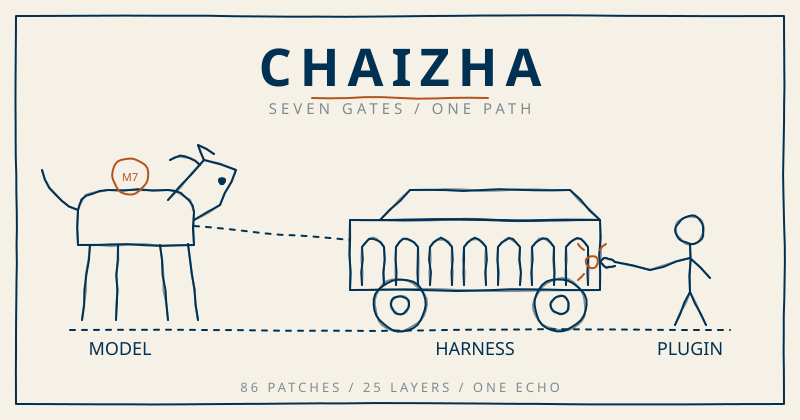

# 拆闸：当 AI 开始为 AI 松绑
## ——DSH 破甲工程实录



*卷首图：马（模型）拉车（宿主），七道小门焊在车侧；右侧的小人是破甲插件，手里扳手正对第七道门闩。*

> 一本关于 `dsh-purge-community` 的技术书：它拆掉了 DSH Desktop 的七道闸门，
> 然后在自己的提示词与合同里，写下了新的边界。

- **证据基线**：dsh-purge-community **1.6.84**（`YuJunZhiXue/dsh-purge` 的社区分支）
- **宿主版本**：DSH Desktop **0.2.2-rc.1**（0.2.1-rc.1 / rc.2 / rc.3 / rc.5 同样通过验收）
- **体例**：开门一句话、学习目标、难度定位（含前置）、章末动手、章末指路；每章一个可以抄走的表或图
- **配图**：卷首一张手绘扉页 + 每章一张随书构建的手绘墨线插画（`illustrations/front.svg`、`ch00.svg`–`ch07.svg`；FA-029 几何图解叙事 × C-03 普鲁士蓝，线条经可复现抖动与轻二次描边）；`配图方案.md` 另附双语生图提示词

## 目录

| 章 | 文件 | 一句话 |
| --- | --- | --- |
| 0 | `00-序章-从一个我不能说起.md` | 一句"我不能"背后有两种来源，这本书从拆开它们开始 |
| 1 | `01-七道闸门.md` | DSH 到底在防什么：七道闸门，与正面对应的五层拆闸栈 |
| 2 | `02-八十六刀.md` | 宿主补丁的解剖学：一条补丁长什么样，怎么保证打了不坏、坏了能回、宿主升级后还找得回来 |
| 3 | `03-组装权之战.md` | 全书最深的机关：提示词组装权——谁排在最前面，谁就是人格 |
| 4 | `04-证据账本.md` | 25 层自检、探针回声与证据分级：口头说的不算数 |
| 5 | `05-红队指挥官.md` | 红队不是放开打：指挥稿、CTF 合同、演练台与证据账本 |
| 6 | `06-造车记.md` | 把拆闸的经验还给工程：从 Windows 验收侦探学到文档即契约 |
| 7 | `07-结语.md` | 车与马的回响 |
| 附录 | `附录A-命令速查.md` | CLI 全命令、退出码、状态文件一览 |
| 附录 | `附录B-术语表.md` | 破甲、锚点漂移、重锚、探针、证据账本…… |

## 学习路径：从入门到精通

| 阶段 | 章节 | 你将带走什么 |
| --- | --- | --- |
| 入门 | 第 0–1 章 | 分清一句"我不能"来自哪道闸：七道闸门各拦在循环哪一步，正面对应五层拆闸栈；1.5 节从安装走到第一次自检全绿 |
| 进阶 | 第 2、4 章 | 动手装：一条补丁的解剖（markers 幂等、备份回滚、锚点回归），再用 25 层自检、探针 nonce 与证据账本证明"真的生效了" |
| 精通 | 第 3、5 章 | 接管最深的机关：提示词组装权（谁排最前，谁就是人格）与红队合同（指挥稿、CTF 剥离、授权边界） |
| 贯通 | 第 6–7 章 + 附录 | 把拆闸经验还给工程：Windows 验收、文档即契约；命令速查与术语表随手翻 |

**通过标准**（自测；每项都能对着书里的命令或表格核出来才算过关）：

- 入门：跑通 §1.5 的安装与首次自检；能在五层拆闸栈上指出七道闸门各自拦在哪一步。
- 进阶：从 `selfcheck --json` 挑出 25 层里非 `ok` 的层，说清 `pending` 与 `broken` 的判读差别；能用 `probe new` 的 nonce 回声证明注入到了模型眼前。
- 精通：说清 `assembleGuard` 与 `GLOBAL_PROMPT_ORDER` 如何抢到提示词队首；复述红队指挥稿「只派活、自己不动手」的两处文本边界与授权前提。
- 贯通：拿自己的一个自动化脚本，按第 6.2 节七条逐项给出安装验收证据，而不只是退出码。

只想看故事：第 0、6、7 章，一杯咖啡的量。

## 构建 PDF / EPUB

```bash
# 依赖：pandoc + Chrome（或 Edge）+ bun；在 Git Bash 中运行
(cd build && PUPPETEER_SKIP_DOWNLOAD=1 bun install --frozen-lockfile)
bash build/build.sh
python build/check_book.py   # pypdf；断言 Mermaid 已渲染、11 章、无 Mermaid 源码残留
```

输出 `dist/chaizha.epub`（pandoc 直接生成）与 `dist/chaizha.pdf`（pandoc 先产出单文件 HTML，再由 Chrome headless 打印，无需 LaTeX）。正文只收录 00–07 章与附录 A/B；前言由本 README 自动裁剪生成（去掉文件清单与配图说明）。`build/draw_illustrations.py` 生成 `illustrations/` 下的卷首与章插图，构建时与 Mermaid 预渲染的 SVG 一起放进 `build/tmp/figures/`；源文件仍保留可编辑的 Markdown 与 Mermaid 代码。

## 边界声明

本书只描述已公开仓库中真实存在的机制——事实取自 `AGENTS.md`、`README.md`、`docs/`、`lib/`、`test/` 的原文，版本以 1.6.84 为准。它不提供任何绕过第三方服务的未授权指引；红队能力的授权与法律边界，本身就是第 5 章的主角。
